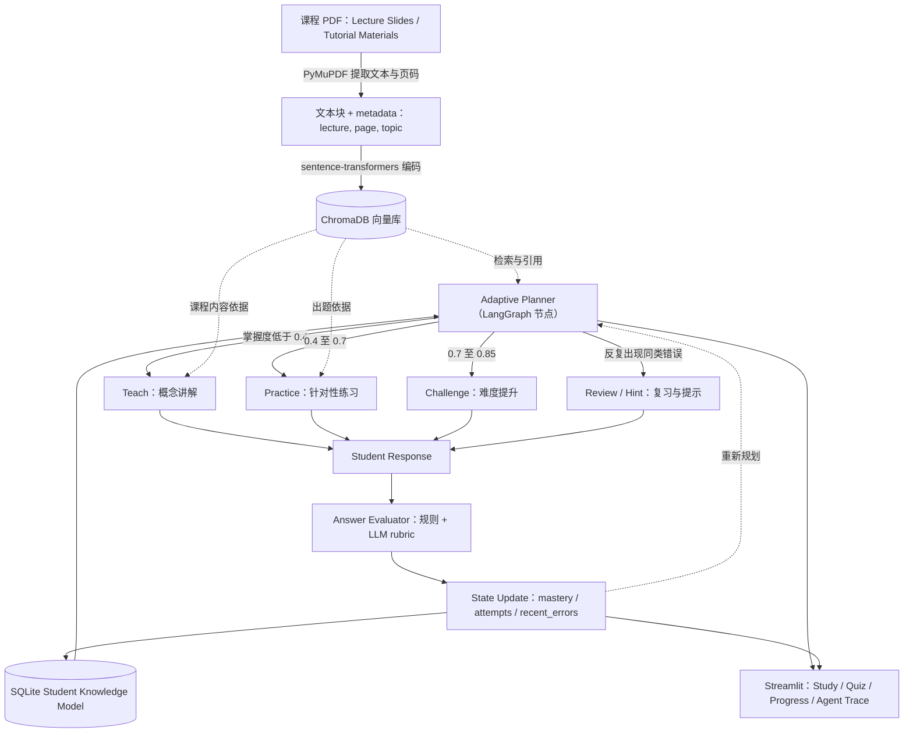

# Adaptive Study Assistant Agent

> **A Performance-Aware Agent for Personalized Learning**  
> AI Concepts 课程项目 · 依据 `Project Proposal（中文）.docx` 与课程报告要求（Motivation → Description → Implementation → Data → Experiment → Discussion）编写


| 项目信息 | 内容                                                                                  |
| ---- | ----------------------------------------------------------------------------------- |
| 项目名称 | Adaptive Study Assistant Agent: A Performance-Aware Agent for Personalized Learning |
| 项目类型 | 课程项目 / 原型系统（Prototype）                                                              |
| 目标用户 | 需要自主学习专业课程知识的大学生                                                                    |
| 核心问题 |                                                                                     |
| 当前状态 |                                                                                     |


> **当前进度**：P0–P4 已完成——P3 最小闭环是第一个可运行里程碑；P4 已**默认接入** OpenRouter **免费模型**（grounded 讲解、结构化 JSON 出题、Challenge / Review），并补齐本地 `.env` 密钥安全与缺 Key 明确提示，全量 **71 项离线测试通过**。平台启动即走 LLM，无需任何模式开关；把 Key 填进本地 `.env`（绝不入库）即可在线运行，缺 Key 会打印配置步骤并退出 2，不会静默降级。`app.py`、P5 UI/Trace、P6 冻结接口、数据与实验脚本，以及 §9.4 中 Streamlit / 实验命令仍是**规划蓝图（Planned / To be implemented）**，用于指导实现与保证可复现性，不代表对应文件已经存在。


---

## 目录

- [1. 项目简介](#1-项目简介)
- [2. 背景与动机](#2-背景与动机)
- [3. 研究目标与贡献](#3-研究目标与贡献)
- [4. 功能特性](#4-功能特性)
- [5. 系统架构](#5-系统架构)
- [6. 核心模块与技术栈](#6-核心模块与技术栈)
- [7. 核心逻辑与规则](#7-核心逻辑与规则)
- [8. 项目结构](#8-项目结构)
- [9. 快速开始](#9-快速开始)
- [10. 实验与评估](#10-实验与评估)
- [11. 课程报告对应关系](#11-课程报告对应关系)
- [12. 开发路线图](#12-开发路线图)
- [13. 当前状态与局限](#13-当前状态与局限)
- [14. 开发约定](#14-开发约定)
- [15. 常见问题](#15-常见问题)
- [16. 许可证与致谢](#16-许可证与致谢)
- [17. 参考文档](#17-参考文档)

---

## 1. 项目简介

本项目把传统 AI Tutor 从「学生提问 → 模型回答」的被动问答系统，扩展为一个**有状态的、自适应规划的学习 Agent（stateful agentic tutoring loop）**。系统持续维护学生在各知识点上的掌握度与错误记录，在每次作答后评估答案、更新状态，并由 Adaptive Planner 重新决定下一项学习活动（讲解、练习、挑战或复习），形成 `Plan → Act → Observe → Update → Re-plan` 的闭环。

课程材料通过 RAG（Retrieval-Augmented Generation）建立知识库，保证讲解与出题 grounded 在具体课件上并可给出引用；LLM 只负责生成与评估，不负责决定学习路径的状态逻辑。这种「状态可查、决策可解释、过程可追溯」的设计，是本项目区别于普通 chatbot 的关键。

## 2. 背景与动机

- **现有系统的局限**：随着 LLM 的发展，AI Tutor 已能提供课程问答、知识解释与习题讲解，但主流系统仍以「解决学生当前问题」为目标，不持续分析学习状态，也不决定后续学习策略。
- **真实学习需求**：不同学生对同一知识点的掌握程度与错误模式差异显著，固定教学内容与固定学习顺序难以满足个性化需求；大学生自主复习时尤其需要针对知识缺口的动态调整。
- **Agent 视角的意义**：本项目把「学生学习表现」作为 Agent 决策的重要输入，研究 Agent 如何自主决定后续学习行为，而不只是生成当前问题的答案。这使系统具备状态、目标与反馈循环，是典型的 Agent 问题，而非单纯的文本生成问题。
- **可验证性**：通过与 LLM-only、RAG、Fixed-strategy 三类 baseline 对比，检验动态规划是否真正提高学习效果与学习效率。

## 3. 研究目标与贡献

**研究问题**：与静态问答 / 检索增强 / 固定流程的 Tutor 相比，依据学生学习表现进行动态规划的 Agent，是否能够带来更高的学习增益，并用更少的学习活动达到相同或更高的知识掌握程度？

**主要贡献**

1. 提出并实现 **performance-aware adaptive planning mechanism**：将 Student Knowledge Model 的输出作为 Planner 的决策依据，通过反馈循环动态调整学习策略。
2. 构建可对比、可复现的实验框架：四种方法、统一 Pre-test → Learning Session → Post-test 流程、统一评估口径。
3. 提供 **Agent Trace**，把「当前 mastery、recent errors、选择了什么 action、为什么、检索到哪一页」显式呈现，便于解释 Agent 行为。

**范围声明**：RAG 在本项目中是**基础设施而非创新点**，其作用是抑制幻觉并提供 `Source: Lecture 05, Page 14` 形式的引用；创新点集中在自适应规划与状态更新机制。为避免引入与研究问题无直接关系的复杂度，项目不实现多用户认证、复杂前端、分布式部署等功能。

## 4. 功能特性

- 课程 PDF（Lecture Slides、Tutorial Materials）解析、切分、向量化与语义检索，保留 `lecture / page / topic` 元数据用于引用。
- 学生知识模型：按知识点记录 mastery、attempts、correct/incorrect、recent errors、last studied。
- 四类学习活动：**Teach / Practice / Challenge / Review**，由 Planner 依据 mastery 与错误模式选择。
- 混合答案评估：客观题确定性评分，主观题按 rubric 由 LLM 打分。
- 可切换 LLM：通过 OpenRouter 一处 `model` 字符串切换模型，便于 baseline 与成本实验。
- Streamlit 交互界面：Study Page、Quiz Page、Progress Dashboard、Agent Trace Page。
- 实验流水线：四种方法对比、指标计算、结果表格与图表输出。

## 5. 系统架构

整体 Agent workflow：

```
Student State → Adaptive Planning → Learning Activity → Student Response
              → Evaluation → State Update → Re-planning
```

按数据流经过的模块展开：



LangGraph 中的节点对应 `Planner → Action → Evaluate → State Update`，条件边对应四类学习活动的路由，共享 state 承载学生状态与检索结果；`State Update → Re-planning` 构成回边，使系统成为有状态闭环而非一次性调用链。

## 6. 核心模块与技术栈

| 数据流模块    | 使用的技术                                  | 技术是什么                                                    | 在系统中的作用                                                                              |
| -------- | -------------------------------------- | -------------------------------------------------------- | ------------------------------------------------------------------------------------ |
| 课程材料解析   | **PyMuPDF**                            | Python PDF 解析库，提取文本与页面结构                                 | 将 Lecture Slides、Tutorial Materials 转为纯文本，保留页码用于 citation                            |
| 文本向量化    | **sentence-transformers**              | 基于 Transformer 的句子/文本嵌入模型库                               | 把切分后的课程文本块编码为向量，供语义检索                                                                |
| 知识库存储与检索 | **ChromaDB**                           | 轻量级向量数据库，支持相似度检索与 metadata                               | 存储课程向量及 `lecture / page / topic`，为讲解与出题提供 Top-k 上下文                                  |
| 学生状态存储   | **SQLite**                             | 零配置、单文件的嵌入式关系型数据库                                        | 保存每个学生在每个知识点上的 mastery、attempts、对错、recent errors、last studied                        |
| Agent 编排 | **LangGraph**                          | 以图（节点 + 条件边 + 共享 state）构建有状态多步 agent workflow 的框架        | 实现 `Student State → Planner → Action → Evaluate → Update → Re-plan` 闭环，是「Agentic」的核心 |
| 内容与题目生成  | **LLM（经 OpenRouter 接入）**               | OpenRouter 是统一 API 网关，一套接口调用 GPT / Claude / DeepSeek 等模型 | 概念解释、Practice/Challenge 出题、主观题评估；通过 `ChatOpenRouter` 或 OpenAI SDK 修改 `base_url` 接入   |
| 答案评估     | **Python 确定性评分 + LLM rubric**          | 代码直接判对错；LLM 按预设 rubric 给简答题 0/1/2 分                      | 客观题保证可复现，主观题弥补规则评分不足                                                                 |
| 交互与可观测性  | **Streamlit**                          | 纯 Python 快速构建交互式 Web 应用的框架                               | Study / Quiz / Progress Dashboard / Agent Trace 四个页面                                 |
| 实验分析     | **pandas + scikit-learn + matplotlib** | 数据处理、指标计算、绘图库                                            | 汇总四组实验结果，计算 mastery prediction 的 MAE / correlation，绘制 Learning Gain 与 Efficiency 对比图 |

### 关键选型理由

- **SQLite 而非 PostgreSQL**：个人课程项目，零配置、易复现，状态与历史记录规模很小，符合「不引入与研究问题无关的复杂度」的原则。
- **OpenRouter 而非绑定单一厂商**：只改一个 `model` 字符串即可切换模型，便于做 baseline 对比与成本/延迟实验，无需改动 workflow。
- **混合评分**：客观题交给 Python 代码，主观题才交给 LLM，避免 LLM 评分波动污染核心指标 Learning Gain。
- **Planner 先规则、后 LLM**：先用可解释的阈值规则保证实验可控；后续再让 LLM 结合 `recent_errors`、`prerequisite_topics` 做更灵活决策，便于做消融对比。
- **规则之外的 LLM 只做生成与评估**：教学决策的确定性来自状态与规则，LLM 不直接改写学生状态。

## 7. 核心逻辑与规则

### 7.1 Mastery 更新公式

每次作答后按动量式更新，使决策基于动态状态而非单次回答：

```
new_mastery = α × old_mastery + (1 − α) × current_performance
```

- `old_mastery`、`new_mastery`、`current_performance` 均落在 `[0, 1]`；
- `α`（对应配置项 `MASTERY_ALPHA`）控制历史状态的权重，越大越平滑；
- 同时更新 `attempts`、正确/错误计数、`recent_errors`（用于 Review 判定）与 `last studied`。

规划伪代码（非最终实现）：

```python
def update_mastery(old_mastery, performance, alpha=0.7):
    return alpha * old_mastery + (1 - alpha) * performance
```

### 7.2 Adaptive Planner 决策策略

| 条件                     | Action            | 说明                   |
| ---------------------- | ----------------- | -------------------- |
| `mastery < 0.4`        | **Teach**         | 概念讲解，附检索到的课程页码引用     |
| `0.4 ≤ mastery < 0.7`  | **Practice**      | 针对薄弱点生成练习题           |
| `0.7 ≤ mastery < 0.85` | **Challenge**     | 提高题目难度               |
| 同一知识点反复出错              | **Review / Hint** | 复习前置知识点或给出提示，优先级高于上表 |
| `mastery ≥ 0.85`       | 进入下一知识点（待实现）      | 推进策略与知识点依赖图在实现阶段补充   |

实现建议：先以纯规则实现上表，再引入 LLM 结合 `recent_errors`、`prerequisite_topics` 做决策，两种模式均可通过配置切换以便对比。

### 7.3 Answer Evaluator

| 题型          | 评分方式           | 输出                  |
| ----------- | -------------- | ------------------- |
| MCQ / 数值题   | Python 确定性判断   | `correct: bool`，可复现 |
| 简答题 / 开放式回答 | LLM 按预设 rubric | `0 / 1 / 2` 分，附简短理由 |

评分结果统一转换为 `[0, 1]` 的 `current_performance` 后写入 mastery 公式，避免不同题型的分数尺度影响状态更新。

### 7.4 Agent Trace 记录字段

每一步至少记录：`student_id`、`topic`、`mastery_before / after`、`recent_errors`、`selected_action` 及选择依据、检索命中的 `lecture / page`、`evaluation_result`、`latency`、`llm_cost`。该记录既用于 Agent Trace Page 展示，也是实验结果分析的原始日志。

## 8. 项目结构

以下为结构约定：P0–P4 的目录骨架、配置文件、知识库/状态模型/最小闭环/LLM 内容生成代码与测试已创建；树中 `app.py`、`src/agent/session.py`、`src/ui/...` 等模块文件是 P5–P6 的规划目标，尚未创建：

```text
Adaptive-Study-Assistant-Agent_AI-Concepts-Project/
├── README.md                       # 本文件：项目说明与使用文档
├── requirements.txt                # Python 依赖（P0 已创建）
├── .env.example                    # 密钥 / 端点模板（P0 已创建，不含真实密钥）
├── .gitignore                      # 忽略 .env / 数据 / 向量库 / 数据库（P0 已创建）
├── pytest.ini                      # pytest 配置（P0 已创建）
├── app.py                          # Streamlit 应用入口（P5）
├── config.yaml                     # 阈值、模型、路径等非敏感配置（P0 已创建，唯一配置源）
├── data/
│   ├── course_materials/           # 原始课程 PDF（受版权保护，不入库）
│   ├── chroma_db/                  # ChromaDB 持久化目录（不入库）
│   └── student_state.db            # SQLite 学生状态（不入库）
├── src/
│   ├── ingestion/                  # pdf_parser.py / chunker.py / indexer.py（P1 已创建）
│   ├── retrieval/                  # embeddings.py / vector_store.py（P1 已创建）
│   ├── student_model/              # schema.sql / state.py / mastery.py（P2 已创建，含 events 表）
│   ├── agent/                      # graph.py / planner.py / actions.py / evaluator.py / questions.py / run.py（P3）；llm_content.py + prompts/{__init__,templates}.py（P4 已创建）；session.py 待 P6
│   ├── ui/                         # study.py / quiz.py / progress.py / trace.py（P5）
│   └── utils/                      # config.py / llm_client.py（P0）、secret_guard.py（P4）、logging.py（后续）
├── experiments/
│   ├── run_experiment.py           # Pre-test → Session → Post-test 驱动
│   ├── baselines/                  # llm_only.py / rag_tutor.py / fixed_strategy.py
│   ├── metrics.py                  # Learning Gain / Final Mastery / Efficiency 等
│   ├── plots.py                    # matplotlib 对比图
│   └── results/                    # 结果 CSV / 图表（可入库，用于复现）
├── tests/                          # 单元测试（P0–P4 共 71 项；后续: UI / 冻结契约 / 实验指标）
└── report/                         # 课程报告与 Presentation 材料
```


## 9. 快速开始

> §9.2 安装、§9.3 配置、§9.5 测试，以及 §9.4 中 P0 冒烟、P1 索引、P3/P4 闭环 CLI 与密钥检查命令已可立即执行；在线 LLM 调用需先在本地 `.env` 填入 Key，Streamlit 与实验命令**需 P5–P6 代码实现完成后才可执行**。

### 9.1 环境要求

- Python 3.10 及以上、pip、Git
- 可运行 sentence-transformers 的内存（建议 ≥ 4 GB 可用内存）
- OpenRouter API Key（**默认平台运行需要**，填在本地 `.env`；默认用免费 `google/gemma-4-31b-it:free`，无需信用卡）。仅 P1 索引、全部 71 项离线测试，以及显式 `--offline` 运行不需要 Key
- 目标课程的 Lecture Slides、Tutorial Materials 等 PDF 材料（受版权保护，不入库）

### 9.2 安装

```bash
git clone <repository-url>
cd Adaptive-Study-Assistant-Agent_AI-Concepts-Project

python -m venv .venv
# Windows (PowerShell)：.venv\Scripts\Activate.ps1
# Windows (Git Bash)：source .venv/Scripts/activate
# macOS / Linux：source .venv/bin/activate

python -m pip install --upgrade pip
pip install -r requirements.txt
cp .env.example .env        # Windows PowerShell: Copy-Item .env.example .env
```

`requirements.txt` 已按下列清单创建（额外补入读取 `config.yaml` 所需的 `PyYAML`，并加上版本下限与主版本上限；P6 冻结时再执行 `python -m pip freeze > requirements.lock.txt` 生成精确锁）。部分依赖的新版本要求 Python ≥ 3.11，pip 会自动挑选与当前 Python 兼容的版本：

```text
langgraph
langchain-openrouter
openai
pymupdf
sentence-transformers
chromadb
streamlit
pandas
scikit-learn
matplotlib
python-dotenv
pytest
```

### 9.3 配置

`.env` **只放密钥与服务端点**；`config.yaml` 是所有非敏感配置的唯一来源（模型名、`MASTERY_ALPHA`、阈值、`seed`、路径），P6 冻结后实验期间不得修改。模板 `.env.example`：

```dotenv
# 复制为 .env 后填入真实值；.env 已被 .gitignore 忽略
OPENROUTER_API_KEY=sk-or-your-key-here
OPENROUTER_BASE_URL=https://openrouter.ai/api/v1
```

> **密钥安全（P4 强制约定）**：真实 Key 只能存在于本地 `.env`，绝不写入 `config.yaml`、源代码、测试、README、聊天记录或 Issue；`.gitignore` 已忽略 `.env` 及所有 `.env.*` 变体（仅放行 `.env.example`）。提交前运行 `python -m src.utils.secret_guard` 扫描可提交文件；若曾泄露，立刻到 https://openrouter.ai/keys 撤销。未填 Key 时，平台默认路径与 P0 冒烟都会打印本地 `.env` 配置步骤并以退出码 2 结束，**不会静默降级**——避免一次「看起来用了 LLM」、实际跑的是离线模板的运行污染实验记录。仅显式 `--offline` 才允许无 Key 运行。

P4 默认走 OpenRouter **免费模型**（零 token 费用、无需信用卡）：

```yaml
llm:
  model: google/gemma-4-31b-it:free      # 2026-11-11 经 /api/v1/models 核实
  free_fallback_models:                  # 主模型下架时自动重试
    - nvidia/nemotron-3.5-lightning:free
    - liquid/lfm-2.5-2.6b:free
  temperature: 0.0
  max_tokens: 700
```

免费 ID 会轮换，随时用 `python -m src.utils.llm_client --list-free-models` 查看当前零价模型并只改 `llm.model` 即可；`:free` 变体为 50 次/天（20 次/分钟），一次性充值 $10 后为 1000 次/天。切换模型只改 `llm.model`；任何 OpenAI 兼容服务都可把 `OPENROUTER_BASE_URL` 指向它、密钥填入 `OPENROUTER_API_KEY`，Agent workflow 不变。生效配置可由 `config_for_log()` 读出并写入事件日志，供 P6 冻结与实验复现使用。

`config.yaml` 中其余阶段相关项：P1 `embedding.backend`（`auto` / `sentence_transformers` / `hashing`，P6 前必须固定为显式值）、`embedding.model`、`retrieval.{collection_name,chunk_size,chunk_overlap,top_k}`；P2 `mastery.{alpha,initial,recent_errors_window}`；P4 `agent.llm_mode: "on"`（平台默认接入 LLM；`off` 仅由 CLI `--offline` 或测试显式指定，不作为可选模式暴露给用户）、`agent.max_json_retries`、`agent.teach_max_chars`、`agent.grounded_min_hits`。`hashing` 是确定性离线后端，用于无模型环境下的索引与测试；正式对比实验应使用 `sentence_transformers`。

### 9.4 运行

平台**默认接入 LLM**，启动前只需配置一次：复制 `.env.example` 为 `.env`，把 `OPENROUTER_API_KEY` 换成 openrouter.ai/keys 生成的真实值（`.env` 已被忽略，不会入库）。

```bash
# 1) 在线冒烟（确认 Key 与免费模型连通）
python -m src.utils.llm_client

# 2) 平台主路径：LLM grounded 讲解 + 结构化 JSON 出题 + Challenge / Review
python -m src.agent.run --student-id demo --topic "Bayes Theorem" \
    --answers correct,wrong,correct --max-steps 12
# 可选：--no-rag 跳过检索、--db 指定状态库、--no-reset 保留状态、--run-id 固定运行标识
```

缺 Key 时两条命令都会打印本地 `.env` 填写步骤并以退出码 2 结束，**不发网络请求、不静默降级**。

**无需 API Key** 的命令（离线）：

```bash
python -m src.utils.llm_client --check              # 生效配置 + 密钥状态，不发网络请求
python -m src.utils.llm_client --list-free-models   # 查询 OpenRouter 当前零价模型（公开接口，无需 Key）
python -m src.utils.secret_guard                    # 提交前检查：.env 已忽略、无可提交的真实 Key

# 将课程 PDF 放入 data/course_materials/ 后构建向量知识库（重复运行幂等）
python -m src.ingestion.indexer --input data/course_materials --backend hashing
# 可选：--rebuild 全量重建；--topic-map topics.json 把文件名映射为知识点

# 唯一的离线逃生口：显式 --offline，无 Key、无网络、完全可复现（测试与 P6 基线用）
python -m src.agent.run --offline --answers correct,wrong,correct --max-steps 10
```

> **没有模式选择**：`config.yaml` 的 `agent.llm_mode: "on"` 是平台默认路径，启动即接 LLM；`--offline` 是唯一且显式的退出方式，其值写入 `events.config_snapshot` 供 P6 冻结与复现。缺 Key 直接失败而不是降级，保证任何一条 `events` 记录里「用了 LLM」的标注都真实。
>
> LLM **只生成**客观选择题，评分仍由 `evaluator.py` 代码确定性完成；`subjective_rubric_enabled` 保持 `false`，避免评分噪声污染 Learning Gain。讲解的 `Source: Lecture 05, Page 14` 由 P1 检索 metadata 追加，LLM 被明确禁止写引用（生成文本中若有 Source 行会被剥离）。检索为空、缺 Key、模型下架、网络失败或 JSON 不可解析时，都会安全降级到离线模板/静态题库，闭环不中断。每次 LLM 调用的 token、latency、实际回答模型与 cost 会写入 `events` 的既有列，P6 无需补埋点。

> 讲义 PDF 受版权保护不入库；目录为空时索引命令安全返回 0 条并给出提示。`embedding.backend: auto` 在本机没有 sentence-transformers 模型时降级为 `hashing` 并警告，P6 前须固定为显式值。P2 的 SQLite 状态库（含 `events` 表）由 `StudentStateStore` 首次调用时自动创建，无需单独命令。

以下命令需 P5–P6 完成后才可执行：

```bash
# 2) 启动交互应用（Study / Quiz / Progress / Agent Trace）
streamlit run app.py

# 3) 运行四组方法的对比实验
python -m experiments.run_experiment --methods llm_only,rag,fixed,adaptive

# 4) 生成指标表与图表
python -m experiments.plots --input experiments/results/
```

### 9.5 测试

```bash
pytest tests/ -v
```

现有 **71 项离线测试**，无需 API Key、无需网络即可全部通过：

| 测试文件 | 阶段 | 覆盖 |
|---|---|---|
| `tests/test_p0_smoke.py` | P0（14 项） | 配置加载、`.env` 模板、`.gitignore`、依赖清单、目录骨架、LLM 客户端桩调用 |
| `tests/test_p1_rag.py` | P1（11 项） | 合成 PDF 的物理页码 / topic metadata、确定性 chunk id、按 topic 命中正确讲义页、幂等重建、同进程重开索引、`Source: Lecture 05, Page 14` 引用、空目录降级 |
| `tests/test_p2_student_model.py` | P2（10 项） | mastery 公式边界与非法值、重复作答幂等、`recent_errors` 窗口、`events` 表 trace/latency/token/cost 字段、状态持久化与轨迹可复现 |
| `tests/test_p3_loop.py` | P3（11 项） | 规则 Planner 阈值与 Teach→MCQ 转换、确定性评分、CLI 连跑 N 步、每步落 events、mastery 随答题升降、`max_steps` 与达标双退出、同初始状态轨迹一致、检索 citation 落库、空检索降级 |
| `tests/test_p4_llm.py` | P4（25 项） | 默认接入 LLM 的配置快照、缺 Key 明确提示与 `.env`/`.gitignore` 密钥安全、真实 Key 扫描守卫、免费模型目录过滤与下架回退、结构化 JSON 出题（`evaluator` 可稳定解析）、grounded 引用只来自 P1 metadata、空检索/网络失败/坏 JSON 的内容层降级、四类活动路由、`--offline` 逃生口与旧模式参数拒绝、events 记录 token 与实际模型 |

课程 PDF 不入库，P1 测试用 PyMuPDF 运行时生成合成讲义验证检索链路；P3/P4 测试用注入的 LLM 桩客户端覆盖在线逻辑，**不调用真实 OpenRouter、不启动 UI**。真实在线冒烟只需：复制 `.env.example` 为 `.env` → 填入 Key → 运行 `python -m src.utils.llm_client`（或直接跑默认闭环 `python -m src.agent.run`）。

后续阶段建议至少覆盖：P5 刷新后状态不丢、P6 `run_session` 契约与同 profile 两次运行轨迹一致。

## 10. 实验与评估

### 10.1 数据

- 来源：目标课程的 **Lecture Slides、Tutorial Materials** 等课程资料。
- 派生数据：基于课程材料构建知识点（含**不同难度与依赖关系**）、练习题与测试题。
- 可复现设计：除实际用户测试外，使用**预先定义的学生学习状态与评价任务**进行模拟实验，保证四种方法在相同初始条件下公平比较。

### 10.2 实验流程

```
Pre-test（获得初始学习状态）
    → Learning Session（使用指定 Tutor 方法学习）
    → Post-test（衡量学习效果）
```

### 10.3 对比方法

| 方法                                      | 课程检索 | 学生状态      | 学习策略                     |
| --------------------------------------- | ---- | --------- | ------------------------ |
| **LLM-only Tutor**                      | 无    | 不使用       | 直接回答学生问题                 |
| **RAG Tutor**                           | 有    | 不使用       | 检索增强讲解，策略固定              |
| **Fixed-strategy Tutor**                | 有    | 不使用（或仅记录） | 预先定义的固定学习流程              |
| **Adaptive Study Assistant Agent**（本项目） | 有    | 使用        | 依据 mastery / errors 动态规划 |

### 10.4 评价指标

| 指标                      | 定义                                       |
| ----------------------- | ---------------------------------------- |
| **Learning Gain**       | Pre-test 到 Post-test 的学习提升（核心指标）         |
| **Final Mastery**       | 学习过程结束后的知识掌握程度                           |
| **Learning Efficiency** | 达到预设目标掌握程度所需的学习活动数量                      |
| **Response Latency**    | 响应时间，用于分析 Adaptive Planning 的额外开销        |
| **LLM Cost**            | LLM 使用成本，用于分析开销与收益的权衡                    |
| Mastery prediction 辅助指标 | MAE、correlation（scikit-learn），检验状态估计是否合理 |

结果用 pandas 汇总、scikit-learn 计算指标、matplotlib 绘制 Learning Gain / Efficiency 对比图，输出到 `experiments/results/`，供课程报告与 Presentation 使用。分析重点：Adaptive Agent 是否取得更高学习增益、是否用更少活动达到同等掌握程度、自适应决策在哪些情况下有效、以及其局限性。

## 11. 课程报告对应关系

| 报告章节               | 主要内容                                   | 对应本 README  |
| ------------------ | -------------------------------------- | ----------- |
| **Motivation**     | 被动问答的局限、个性化学习需求、目标用户                   | §2、§3       |
| **Description**    | 系统整体设计、Agent workflow、创新点定位            | §1、§5、§6    |
| **Implementation** | 各模块技术选型、LangGraph 闭环、mastery 公式、评分与 UI | §6、§7、§9    |
| **Data**           | 课程 PDF、知识点与题目构建、模拟学生状态                 | §10.1、§8    |
| **Experiment**     | 四种方法、Pre/Post-test 流程、指标与工具            | §10.2–§10.4 |
| **Discussion**     | 结果分析、开销权衡、有效场景与局限                      | §10.4、§13   |

## 12. 开发路线图

**开发顺序决策**：先完成平台基础开发（P0–P6），冻结接口与配置后，再进入实验评估（E1–E3）。原因是 Learning Gain、Final Mastery、Learning Efficiency 的可信度依赖平台的状态更新、评分口径与日志一致；平台未冻结就跑实验，任何一次代码改动都会让四种方法的结果不可比。

### 12.1 平台基础开发路径（P0 → P6）

依赖关系：`P0 → (P1 ∥ P2) → P3 → P4 → P5 → P6`，其中 P1 与 P2 可并行，P3 必须等两者都就绪。

| 阶段 | 目标 | 主要落地文件 | 进入下一阶段的验收标准 |
|---|---|---|---|
| **P0 工程骨架** | 建目录、锁依赖、外置配置、打通 LLM 调用 | `requirements.txt`、`.env.example`、`config.yaml`、`.gitignore`、`src/utils/llm_client.py` | `.env` 不入库；最小调用能返回模型响应；`pytest` 可运行 |
| **P1 RAG 知识库** | PDF → 文本块 → 向量 → 语义检索 | `src/ingestion/{pdf_parser,chunker,indexer}.py`、`src/retrieval/{embeddings,vector_store}.py` | 按 topic 检索命中正确讲义页；索引可幂等重建；能拼出 `Source: Lecture 05, Page 14` |
| **P2 学生状态模型** | 状态持久化、mastery 更新、事件日志表 | `src/student_model/{schema.sql,state.py,mastery.py}`、`data/student_state.db` | 单测覆盖公式边界、重复作答、recent_errors 窗口；`get_state()` 可供 Planner 读取 |
| **P3 最小闭环（垂直切片）** | 先只做 Teach + MCQ + 规则 Planner，跑通一次完整闭环 | `src/agent/{graph.py,planner.py,actions.py,evaluator.py,run.py}` | CLI 连续跑 N 步；DB 中 mastery 随答题变化；每步写入 events；同初始状态可复现 |
| **P4 接入 LLM 内容生成** | 讲解与出题 grounded 在检索结果上，补齐 Challenge / Review | `src/agent/prompts/*`、`config.yaml` 阈值 | 生成题目为可解析的结构化 JSON；讲解带页码引用；检索为空时安全降级 |
| **P5 Streamlit 与 Agent Trace** | 可交互的完整学习系统 | `app.py`、`src/ui/{study,quiz,progress,trace}.py` | 浏览器内完成一次学习会话并查看 Trace；刷新后状态不丢 |
| **P6 平台冻结（闸门）** | 固定配置与版本，定义平台 / 实验的接口契约 | `src/agent/session.py` 暴露 `run_session(method, student_profile, topics)`；记录 model / α / 阈值 / seed / 版本 | 同一 profile 两次运行的状态轨迹一致；事件日志含 latency 与 token/cost 字段 |

### 12.2 平台开发的关键原则

- **垂直切片优先**：P3 先只做 `Teach + MCQ + 确定性评分 + 规则 Planner`，不要一上来把四类活动和 LLM 全接上；闭环先跑通再扩展。
- **先 CLI 后 UI**：闭环未在命令行验证前不写 Streamlit，避免把调试时间耗在界面重跑上。
- **日志先行**：`events` 表在 P2 就建好，否则 P5 做 Agent Trace、E 阶段算指标时要返工补埋点。
- **主观题 LLM rubric 评分延后**：先只用客观题，保护 Learning Gain 不被评分波动污染；需要时再作为独立开关加入。
- **回边必须有终止条件**：LangGraph 的 `State Update → Re-planning` 要设 `max_steps` 与 mastery 达标退出，防止死循环。
- **平台与实验解耦**：`run_session(method, ...)` 是唯一分界线，`llm_only / rag / fixed / adaptive` 只是 `method` 参数，共用同一套 Pre/Post-test 与评分口径；三个 baseline 的实现放到 E1，不在平台层提前混写。
- **配置集中**：模型名、`MASTERY_ALPHA`、阈值、随机种子、路径全部外置；P6 冻结后实验期间不得修改。

### 12.3 实验评估（P6 通过后才开始）

- [ ] **E1**：构造知识点、题目与预定义学生 profile；实现三个 baseline 的 `method` 分支
- [ ] **E2**：按 `Pre-test → Learning Session → Post-test` 跑四组实验，产出 `experiments/results/`
- [ ] **E3**：计算 Learning Gain / Final Mastery / Efficiency 与 latency / cost，绘图并完成报告 Discussion

### 12.4 里程碑

- [x] 完成 Project Proposal，明确研究问题与评估方案
- [x] 完成 README 项目说明与技术设计文档
- [x] P0 工程骨架（依赖可解析、`.env` 不入库、14 项离线测试通过；在线 LLM 冒烟待填 API Key 执行）
- [x] P1 RAG 知识库 / P2 学生状态模型（可并行）（34 项离线测试通过；真实讲义 PDF 与在线 LLM 冒烟待补）
- [x] P3 最小闭环可运行（平台第一个可用里程碑）（CLI 连跑 N 步、mastery 随答题变化、每步落 events、双退出与轨迹可复现均通过）
- [x] P4 LLM 内容生成（**平台默认接入** OpenRouter 免费模型、grounded 讲解、结构化出题、Challenge / Review、缺 Key 明确提示不降级、`--offline` 唯一逃生口；71 项离线测试通过；在线调用待本地 `.env` 填 Key 后执行）
- [ ] P5 UI 与 Agent Trace
- [ ] P6 平台冻结，进入实验评估
- [ ] E1–E3 实验与课程报告

## 13. 当前状态与局限

**当前状态**：P0–P4 已完成。P3 是第一个可运行里程碑，P4 在其上接入 OpenRouter 免费模型；**P6 冻结闸门之前的平台能力已基本齐备，仅差 P5 的 UI 与 Trace**。

- **P0**：依赖清单、配置外置、`.gitignore`、`pytest.ini`、`src/utils/{config.py,llm_client.py}`、目录骨架与 14 项测试；`pip install --dry-run -r requirements.txt` 解析通过。
- **P1**：`pdf_parser / chunker / indexer` + `embeddings / vector_store`；PyMuPDF 逐页保留 `lecture / page / topic`，ChromaDB 幂等 upsert 与全量重建，`Source: Lecture 05, Page 14` 引用可用；索引 CLI 在空目录与合成讲义两种情况下均已端到端跑通。
- **P2**：SQLite `student_topic_state` + **`events` 日志表**（含 action / mastery_before-after / citation / latency / token / cost / model / config_snapshot）、mastery 公式、`get_state()`、`event_key` 幂等作答、`recent_errors` 窗口、`reset()` 可复现轨迹。
- **P3**：`src/agent/{graph,planner,actions,evaluator,questions,run}.py`；LangGraph 四节点 `Planner → Action → Evaluate → State Update → Re-plan`，规则 Planner 只输出 `Teach / MCQ / Done`，双退出防死循环、每步落 events、同初始状态轨迹可复现。
- **P4**：`src/agent/llm_content.py` + `src/agent/prompts/templates.py` + `src/utils/secret_guard.py`；默认免费模型 `google/gemma-4-31b-it:free`（官方目录核实）、模型下架自动回退、grounded 讲解、严格 JSON 出题与解析重试、`Challenge / Review` 两类活动；**平台默认接入 LLM**（`agent.llm_mode: "on"`），缺 Key 明确提示并退出 2 而不静默降级，唯一的离线逃生口是显式 `--offline`。LLM 只出题不评分，`subjective_rubric_enabled` 仍为 `false`；每次调用的真实 token/latency/模型写入 `events`。
- 全量 `pytest tests/ -v`：**71 passed**，无需 API Key、无需网络；真实端到端已验证「合成 PDF → P1 索引 → P3/P4 Teach 引用 → P2 events」。

**未完成**：在线 LLM 调用因本机未把 Key 填入本地 `.env` 尚未执行（复制 `.env.example` 为 `.env` → 填 Key → `python -m src.utils.llm_client`，或直接跑默认闭环 `python -m src.agent.run`）；真实讲义 PDF 未入库，P1 命中率仍用合成 PDF 验证；`embedding.backend` 为 `auto`，本机降级到 `hashing`，P6 冻结前须改为显式值。P5 UI/Trace、P6 冻结接口与实验脚本尚未创建，§8 树中相应文件与 §9.4 的 Streamlit / 实验命令仍为规划蓝图。**密钥从未写入仓库任何文件，`python -m src.utils.secret_guard` 检查通过。**

**已知局限（也是 Discussion 章节的素材）**

- Mastery 公式是指数加权的简化模型，未刻画遗忘曲线、知识点先修关系与题目难度差异。
- 主观题 LLM rubric 评分仍未启用（`evaluation.subjective_rubric_enabled: false`）；P4 的 LLM 只负责生成客观题与讲解，评分完全由代码完成，避免评分波动污染核心指标。
- 课程材料可能受版权保护，仓库只提交代码与配置，不提交原始 PDF；引用仅保留 `lecture / page` 定位信息。P1 的检索验收因此用合成 PDF 完成，真实讲义上的命中率需在拿到课程材料后复测。
- 离线 `hashing` embedding 是确定性词袋哈希，不是语义嵌入，只用于无模型环境下的链路验证；正式实验必须使用 `sentence_transformers`，并在 P6 冻结 `embedding.backend`。
- P3 静态题库与 P4 LLM 出题都只服务于平台验证；正式知识点 / 题目 / 学生 profile 由 E1 构造。LLM 生成题目存在措辞与难度波动，`temperature=0.0` 与解析校验只能降低、不能消除该波动。**P6 冻结前不得用 P3/P4 轨迹计算 Learning Gain 等实验指标。**
- 免费 `:free` 模型有 50 次/天（20 次/分钟）限额、ID 会轮换、高峰可能排队，且部分提供方可能按隐私政策记录提示词；平台默认走 LLM，因此每次运行都会消耗额度，正式实验应在 P6 固定模型与额度预算（离线基线用 `--offline`）。
- Adaptive Planning 引入额外 LLM 调用，可能带来延迟与成本上升，需结合 Efficiency 指标权衡。
- 模拟学生状态与小规模用户测试的外推性有限，结论适用范围需在报告中说明。
- `mastery ≥ 0.85` 之后的知识点推进策略、知识点依赖图尚未定义，实现阶段补充。

## 14. 开发约定

- Python 3.10+；代码格式化建议 `black` / `ruff`，测试用 `pytest`。
- 敏感信息与大文件**不得入库**，`.gitignore` 已创建，核心规则如下（另含 `.venv/`、`.pytest_cache/` 等缓存目录，并用 `.gitkeep` 保留目录骨架）：

```gitignore
.env
.env.*
!.env.example
.venv/
__pycache__/
*.pyc
data/course_materials/
data/chroma_db/
*.db
.ipynb_checkpoints/
```

- **密钥三条铁律**：① 真实 `OPENROUTER_API_KEY` 只写本地 `.env`，绝不出现在 `config.yaml`、代码、测试、文档、日志或聊天中；② 每次提交前运行 `python -m src.utils.secret_guard`（扫描可提交文件 + 校验 `.env` 忽略规则，失败返回 1）；③ 一旦疑似泄露立即到 https://openrouter.ai/keys 撤销并换新 Key。`.env` 不入库，所以换 Key 无需改代码。
- 阈值、模型名、`seed`、路径统一放在 `config.yaml`（唯一配置源），`.env` 只放密钥与服务端点，不在业务代码中硬编码。
- 每次实验运行产出独立结果文件（含方法名、模型名、随机种子与时间），保证可复现。
- 提交信息建议格式：`feat: ...` / `fix: ...` / `exp: ...` / `docs: ...`。
- 新增 baseline 时必须复用同一 Pre-test / Post-test 与评分口径，否则结果不可比。

## 15. 常见问题

**Q：为什么用 SQLite 而不是 PostgreSQL？**  
A：单文件、零配置、易复现，规模足以保存学生状态与历史；避免与研究问题无关的工程复杂度。

**Q：可以不用 OpenRouter 吗？**  
A：可以。OpenRouter 只是统一网关；也可直接用 OpenAI SDK 修改 `base_url` 接入其他兼容服务，只需把 `config.yaml` 的 `llm.model` 换成该服务的模型名、并在 `.env` 中替换密钥与端点，Agent workflow 不变。

**Q：为什么 Planner 建议先用规则？**  
A：阈值规则可解释、可复现，便于把「自适应规划」这一变量独立出来做消融实验；LLM Planner 作为后续对比模式。

**Q：引用（citation）怎么实现？**  
A：PyMuPDF 解析时把 `lecture / page / topic` 写入 ChromaDB metadata；P4 把检索片段连同标签喂给 LLM，但**禁止 LLM 自己写引用**——平台在生成文本之后从命中 chunk 追加 `Source: Lecture 05, Page 14`，并剥离模型可能编造的 Source 行，因此 trace 里的引用始终可核验。

**Q：没有 API Key 能运行吗？**  
A：平台默认接入 LLM，所以**跑闭环需要 Key**；缺 Key 会打印本地 `.env` 填写步骤并以退出码 2 结束，不会自动降级（避免把离线运行误记成 LLM 运行）。不需要 Key 的有：P1 索引、全部 71 项离线测试、`--list-free-models`、`--check`、`secret_guard`，以及显式 `python -m src.agent.run --offline` 的离线闭环。

**Q：为什么默认用免费模型，会不会影响实验？**  
A：默认 `google/gemma-4-31b-it:free` 是为了零成本跑通链路；`:free` 模型有 50 次/天限额且 ID 会轮换，所以提供 `--list-free-models` 查询、模型下架自动回退，并把实际回答模型写进 `events`。**P6 冻结时必须固定模型与额度预算**；离线基线由显式 `--offline` 提供，其取值写入 `events.config_snapshot`，因此在线/离线两组轨迹仍可区分且各自可复现。

**Q：API Key 放在哪里最安全？**  
A：只在本地 `.env`（已被 `.gitignore` 忽略）。`config.yaml` 只记录非敏感的模型名与参数；提交前跑 `python -m src.utils.secret_guard`。不要把 Key 粘贴到代码、README、测试、聊天窗口或 Issue；若曾泄露立即在 OpenRouter Keys 页面撤销。

## 16. 许可证与致谢

- **License**：本仓库为课程作业项目，暂未指定开源许可证；如需对外发布请先与课程要求及材料版权方确认。
- **课程材料**：Lecture Slides、Tutorial Materials 等版权归原作者 / 开课单位所有，仅用于本项目学习与实验，不随仓库分发。
- **致谢**：感谢 AI Concepts 课程的项目要求与报告结构指引；本项目设计基于 `Project Proposal（中文）.docx`，技术实现参考 LangGraph、ChromaDB、sentence-transformers、PyMuPDF、Streamlit 与 OpenRouter 官方文档。

## 17. 参考文档

- 项目源文件：`Project Proposal（中文）.docx`（Problem and Motivation / Proposed Approach / Implementation and Evaluation Plan）
- 课程报告结构：Motivation → Description → Implementation → Data → Experiment → Discussion
- [LangGraph](https://langchain-ai.github.io/langgraph/) · [ChromaDB](https://docs.trychroma.com/) · [sentence-transformers](https://www.sbert.net/) · [PyMuPDF](https://pymupdf.readthedocs.io/) · [Streamlit](https://docs.streamlit.io/) · [OpenRouter](https://openrouter.ai/docs) · [SQLite](https://www.sqlite.org/docs.html)
