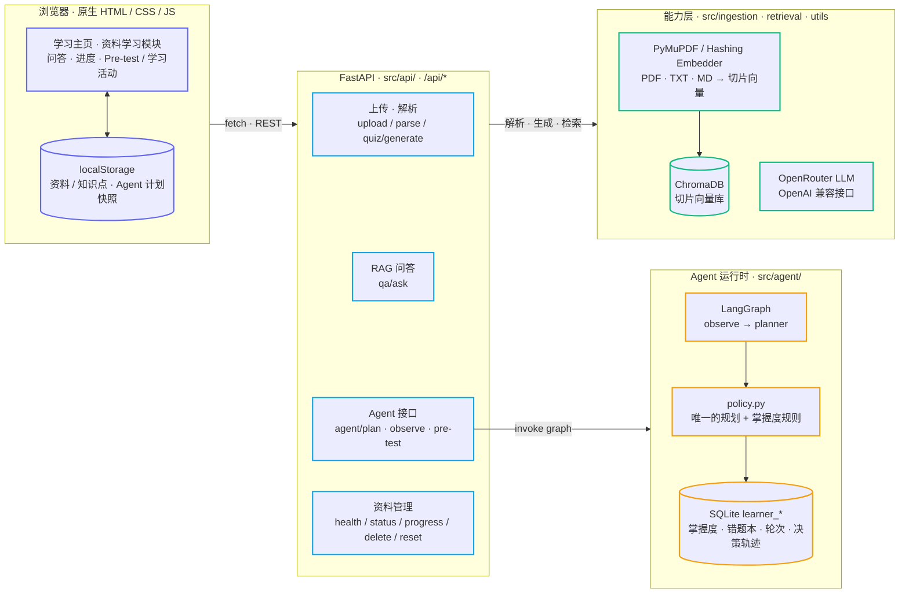

# Adaptive Study Assistant Agent — 学生端

> **面向自主学习的自适应学习助手**  
> 学生自主上传课程资料，系统基于 LLM 与 RAG 自动解析并生成讲解与 quiz，提供自主学习路径推荐与 AI 问答。


| 项目信息 | 内容 |
| ---- | ---- |
| 项目名称 | Adaptive Study Assistant Agent — 学生端 |
| 项目类型 | 课程项目 / 原型系统 |
| 目标用户 | 需要自主学习专业课程知识的大学生 |
| 核心能力 | 学生自主上传课程资料 → LLM 自动解析并生成 quiz；学习主页按资料文件分类进入独立学习模块；课程资料 + AI 问答；学习进度追踪 |

---

## 目录

- [1. 项目简介](#1-项目简介)
- [2. 功能特性](#2-功能特性)
- [3. 系统架构](#3-系统架构)
- [4. 前端技术栈](#4-前端技术栈)
- [5. 后端技术栈](#5-后端技术栈)
- [6. 项目结构](#6-项目结构)
- [7. 快速开始](#7-快速开始)
- [8. API 接口](#8-api-接口)
- [9. 实验与结果复现](#9-实验与结果复现)
- [10. 已知限制](#10-已知限制)
- [11. 开发约定](#11-开发约定)

---

## 1. 项目简介

系统围绕「学生自主上传课程资料」这一入口，形成完整闭环：

```
学生上传课程资料（每份资料 = 一个独立学习模块）
    → LLM 自动解析资料、抽取知识点并生成讲解与 quiz
    → 学习主页按「课程资料文件」分类展示模块卡片，点击选择一份资料
    → 进入该资料模块后才显示自主学习路径：Pre-test → 推荐活动 → 进度追踪
    → 模块内可展开查看课件解析后的知识点（讲解要点 / 生成测验 / 掌握度）
    → 学生完成讲解 / 练习 / 复习，系统只更新该资料的掌握度并重新规划
```

学习主页提供平台功能概览、自主学习规划与课程资料模块入口。选中资料后进入对应模块，完成 Pre-test、讲解 / 练习 / 复习、课件知识点查看与进度追踪，各模块进度独立。「课程资料 · AI 问答」基于上传资料做 RAG 问答并附引用出处；知识点讲解页内也可随时暂停提问，同样由 RAG + LLM 现场作答（以当前讲解页为上下文，答案更贴合正在学的知识点）。

---

## 2. 功能特性

学生端共三个一级页面（另有按资料进入的模块页）+ 三种学习活动：

| 页面 | 功能 |
| ---- | ---- |
| **学习主页** | 平台功能概览、自主学习规划、课程资料文件卡片（知识点数 / 掌握度 / 解析状态）；点击卡片选中资料，点「进入学习模块」进入对应模块 |
| **资料学习模块**（选中资料后） | 该资料的课件解析概览、自主学习路径（先 Pre-test，再由 Agent 推荐下一步）、课件解析后的知识点（可展开查看讲解要点与生成测验）、本资料学习记录 |
| **课程资料 · 问答** | 自主上传课程资料（PDF / TXT / MD）、AI 解析资料生成知识点与 quiz、AI 问答（带引用出处）、从资料列表直接进入模块 |
| **学习进度** | 按资料范围筛选的整体掌握度、各知识点掌握度条形图、学习轨迹 |

> **按资料隔离**：每个知识点通过 `_materialId` 绑定所属资料，Pre-test 状态、掌握度、推荐活动与学习记录都只在该资料模块内生效，不同资料之间互不干扰。

三种学习活动（由 `src/agent/policy.py` 按「错题本 + 连续失败 + 是否学过讲解」分派，不是单纯的分数阈值）：

| 活动 | 触发条件（policy.decide 的分支顺序） | 说明 |
| ---- | ---- | ---- |
| **知识点讲解** | 连续 2 次练习正确率 < 50%（重学）／ 从未看过讲解 | 基于上传资料生成的分页讲解，可随时暂停提问（RAG + LLM 现场作答，并附引用出处）；看完最多到 55% |
| **知识复习** | 错题本还有 ≥ 2 道题 | 针对历史错误的闪卡回顾，只清错题、不涨掌握度 |
| **练习测验** | 上面都不满足，且题库非空 | 针对资料内容生成的测验题；`Δ = clamp(round((正确率×100 − 掌握度)×0.6), −10, +25)` |
| **收尾** | 掌握度 ≥ 80% 且错题清空 | 该知识点结束，不再推荐活动 |

自适应规划遵循 `Plan → Act（浏览器）→ Observe → Update → Re-plan` 闭环：每次作答后由 agent 更新掌握度与错题本，再重新排出本轮下一步。

---

## 3. 系统架构



上传 → 切片向量化入库 → LLM 生成知识点 / 讲解 / quiz → 前端按资料归属；问答时检索相关片段 + LLM 作答并附引用。

**规划只有一条路径**：页面上的「下一步」不再是前端算出来的，而是 `POST /api/agent/plan` 调用 LangGraph agent，由 `src/agent/policy.py` 决策后返回。前端只缓存与渲染这份快照（`localStorage` 里的 `agent.plans`），没有任何备用规则——后端不可用时界面显示「Agent 未连接」，不会偷偷换一套逻辑。

---

## 4. 前端技术栈

前端**完全采用原生 HTML / CSS / JavaScript**，无任何框架与构建步骤（零依赖，双击 `index.html` 即可运行，或经本地静态服务器访问）。

| 组件 | 技术 | 说明 |
| ---- | ---- | ---- |
| 页面结构 | **HTML5** | 单页应用外壳（`#app` 根节点 + hash 路由） |
| 样式 | **CSS3** | `styles.css` 设计系统（CSS 变量、卡片、进度条、环形进度等） |
| 交互逻辑 | **原生 JavaScript** | 模块化 IIFE：`ui.js` / `data.js` / `engine.js` / `views-student.js` / `app.js` / `api.js` |
| 路由 | **hash 路由** | `#/student/dashboard`、`#/student/material/:id`、`#/student/pretest/:id`、`#/student/progress/:scope` 等，无需后端路由 |
| 状态持久化 | **localStorage** | 学习状态（当前资料、掌握度、轨迹）本地保存，刷新不丢 |
| 后端通信 | **fetch API** | `js/api.js` 封装 REST 调用（`/api/*`） |
| 本地服务 | **Node.js 内置 http** | `server.js` 零依赖静态服务器（可选） |

前端脚本依赖关系（`index.html` 中的加载顺序）：

```
js/ui.js              # 图标 + 通用 UI 组件（toast / bar / ring / card）
js/data.js            # 活动类型 + 问答欢迎语（后端不可用时的演示兜底）
js/engine.js          # 按资料隔离的知识模型 + Agent 计划快照（规则在服务端）
js/api.js             # 后端 HTTP API 封装（含 /api/agent/*）
js/views-student.js   # 学习主页 / 资料模块 / 问答 / 进度 / Pre-test / 活动视图
js/app.js             # 应用外壳 + hash 路由（含资料模块与资料级路由参数）
```

---

## 5. 后端技术栈

| 组件 | 技术 | 作用 |
| ---- | ---- | ---- |
| API 框架 | **FastAPI** | 暴露学生端 REST 接口（`src/api/`） |
| LLM 接入 | **OpenRouter**（OpenAI 兼容） | 解析资料抽取知识点、生成 quiz、RAG 问答 |
| 向量检索 | **ChromaDB** | 上传资料的切片向量存储与语义检索 |
| 文本向量化 | **Hashing（确定性词袋哈希）** | 无外部模型依赖，离线可复现的文本向量 |
| 资料解析 | **PyMuPDF** + 纯文本 | PDF / TXT / MD 提取正文 |
| Agent 编排 | **LangGraph** | `observe → planner` 两个节点：先更新状态，再重新规划；`/api/agent/*` 直接 invoke 这个图 |
| 规划策略 | **`src/agent/policy.py`** | 唯一实现（讲解 / 练习 / 复习 / 收尾 + 滚动轮次），无 LLM、纯函数，实验脚本复用同一份 |
| 学习状态 | **SQLite（`learner_*` 表）** | 掌握度、错题本、轮次、决策轨迹（`learner_step`）由服务端持久化 |

---

## 6. 项目结构

```text
Adaptive-Study-Assistant-Agent_AI-Concepts-Project/
├── README.md                       # 本文档
├── requirements.txt                # Python 依赖（含 fastapi / uvicorn）
├── .env.example                    # 密钥 / 端点模板（不含真实密钥）
├── .gitignore                      # 忽略 .env / 数据 / 向量库 / 数据库
├── config.yaml                     # 非敏感配置（唯一配置源）
├── frontend/                       # ★ 学生端前端（原生 HTML/CSS/JS）
│   ├── index.html                  # 入口
│   ├── styles.css                  # 设计系统
│   ├── server.js                   # 零依赖本地静态服务器（可选）
│   ├── package.json                # npm start 脚本
│   └── js/
│       ├── ui.js                   # 图标 + UI 组件
│       ├── data.js                 # 活动类型 + 演示兜底数据
│       ├── engine.js               # 按资料隔离的知识模型 + 自适应规划 + 上传状态
│       ├── api.js                  # 后端 HTTP API 封装
│       ├── views-student.js        # 学习主页 / 资料模块 / 问答 / 进度等视图
│       └── app.js                  # 应用外壳 + 路由
├── src/
│   ├── api/                        # ★ 学生端 HTTP API
│   │   ├── app.py                  # FastAPI 应用与路由（资料 / 问答 / 进度）
│   │   ├── agent.py                # /api/agent/*：规划、状态更新、Pre-test、轨迹
│   │   ├── services.py             # 资料解析 / quiz 生成 / RAG 问答
│   │   └── run.py                  # 启动入口
│   ├── agent/                      # Agent 运行时
│   │   ├── policy.py               # ★ 唯一的自适应策略（决策 + 掌握度 + 滚动轮次）
│   │   ├── learner_store.py        # learner_topic / learner_roll / learner_step
│   │   ├── serve.py                # LangGraph 图 + 服务封装（产品实际调用）
│   │   ├── graph.py                # 内容生成版闭环（CLI / 实验用，含 Teach 渲染）
│   │   ├── planner.py              # 阈值规划器 = 固定策略 baseline（B3）
│   │   └── run.py                  # CLI 驱动
│   ├── ingestion/                  # PDF/TXT 解析与切片
│   ├── retrieval/                  # 向量库与嵌入
│   ├── student_model/              # 学生状态模型（CLI/实验侧）+ events 日志
│   └── utils/                      # 配置 / LLM 客户端 / 密钥守卫
├── data/
│   ├── course_materials/           # 课程 PDF（不入库）
│   ├── uploads/                    # 学生上传的资料（不入库）
│   └── chroma_db/                  # ChromaDB 持久化（不入库）
└── tests/                          # 离线单元测试
```

---

## 7. 快速开始

### 7.1 环境要求

- Python 3.10+、pip
- Node.js ≥ 16（仅前端可选本地服务需要；也可直接用 Python http.server）
- OpenRouter API Key（LLM 解析 / 问答需要，填在本地 `.env`）
- 内存：无大模型加载需求（内置 hashing 嵌入，常规配置即可）

### 7.2 后端安装与启动

```bash
cd Adaptive-Study-Assistant-Agent_AI-Concepts-Project

python -m venv .venv
# Windows (PowerShell)：.venv\Scripts\Activate.ps1
# Windows (Git Bash)：source .venv/Scripts/activate
# macOS / Linux：source .venv/bin/activate

python -m pip install --upgrade pip
pip install -r requirements.txt
cp .env.example .env        # Windows PowerShell: Copy-Item .env.example .env
```

在 `.env` 中填入真实 Key（`.env` 已被 `.gitignore` 忽略，绝不入库）：

```dotenv
OPENROUTER_API_KEY=sk-or-your-key-here
OPENROUTER_BASE_URL=https://openrouter.ai/api/v1
```

启动后端：

```bash
python -m src.api.run --port 8000
# 默认 http://127.0.0.1:8000，健康检查：
# curl http://127.0.0.1:8000/api/health
```

### 7.3 前端启动

```bash
# 方式一（推荐）：Python 静态服务器
cd frontend
python -m http.server 8080

# 方式二：Node 零依赖服务器
cd frontend
npm start        # 或 node server.js

# 方式三：直接双击 index.html（部分浏览器 file:// 下会禁用 localStorage）
```

浏览器打开 http://localhost:8080 ，默认后端地址 `http://localhost:8000`。

> 若后端部署在其他地址，可在浏览器控制台设置 `localStorage.asa_api_base = 'http://你的后端地址'` 后刷新。

---

## 8. API 接口

| 方法 | 路径 | 说明 |
| ---- | ---- | ---- |
| GET | `/api/health` | 健康检查，返回 LLM 配置状态 |
| POST | `/api/materials/upload` | 上传资料（multipart，PDF/TXT/MD） |
| POST | `/api/materials/parse` | LLM 解析资料 → 抽取知识点 + 生成讲解与 quiz；解析途中资料被删除时返回 **410**（结果整体丢弃，不写缓存） |
| GET | `/api/materials/{material_id}` | 查询资料解析状态与缓存结果（刷新后恢复） |
| DELETE | `/api/materials/{material_id}` | 删除指定资料：磁盘文件、ChromaDB 向量、解析缓存、知识点与 agent 学习状态一并清理；在跑的解析线程随后会看到删除标记并丢弃结果 |
| POST | `/api/materials/reset` | 重置全部数据（上传资料、课程材料、ChromaDB 索引与向量库文件），平台回到初始状态 |
| POST | `/api/quiz/generate` | 基于资料生成 quiz（可选独立入口） |
| POST | `/api/qa/ask` | RAG + LLM 问答，返回 `{ answer, sources, grounded, mode }`；可选 `material_id` / `material_name`（限定检索资料）与 `topic` / `focus`（知识点讲解页随堂提问：当前知识点名 + 当页讲解内容，答案按助教讲解方式组织，`mode="tutor"`） |
| GET | `/api/progress` | 已解析知识点列表（掌握度由 agent 在 SQLite 中维护，见 8.1） |

### 8.1 Agent 接口（页面上的「下一步」唯一来源）

| 方法 | 路径 | 说明 |
| --- | --- | --- |
| GET | `/api/agent/policy` | 当前服务的策略与引擎：`{policy:"adaptive-v1", engine:"langgraph"}` |
| POST | `/api/agent/plan` | 重新规划：返回 `{round, steps, next, by_topic, topics}`；`next` 就是界面上的「下一步」 |
| POST | `/api/agent/observe` | 一次活动结束后更新状态并重新规划：返回 `{result:{before,after,delta,note}, ...plan}` |
| POST | `/api/agent/pre-test` | 写入各知识点的起点分（答对 45% / 答错 20% / 跳过不变） |
| GET | `/api/agent/state/{material_id}` | 该资料的权威学习状态 + 最近 20 条决策轨迹 |
| POST | `/api/agent/reset` | 清空某份资料（或全部）的学习状态 |

`plan` 请求里的 `topics` 只在**首次接触**时用于播种（浏览器升级前已有进度不会丢）；之后以 SQLite 为准，浏览器清缓存不会清掉学习记录。

示例（解析资料）：

```bash
curl -X POST http://127.0.0.1:8000/api/materials/parse \
  -H "Content-Type: application/json" \
  -d '{"material_id": "<上传返回的 id>"}'
```

### 8.2 方法 vs 基线（报告口径）

报告里只能有一个 method。当前仓库里确实存在两套掌握度模型，但它们不是"两份没写完的实现"，而是 **method 与 baseline**，边界由 `tests/test_p9_single_method.py` 守着：

| 维度 | Method（被评估） | Baseline（仅对照） |
| ---- | ---- | ---- |
| 代码 | `src/agent/policy.py`（`adaptive-v1`） | `src/student_model/mastery.py` + `src/agent/planner.py` |
| 谁在用 | 产品 `/api/agent/*`（`serve.py`）；后续实验的 adaptive 臂 | 仅 `src/agent/graph.py`（CLI / 基线臂 B0、B3） |
| 掌握度标度 | 0–100 整数百分比 | 0–1 浮点 |
| 更新式 | `Δ = clamp(round((正确率×100 − m) × 0.6), −10, +25)`；讲解首次 +10、重看 +2、封顶 55 | `m' = 0.7·m + 0.3·p` |
| 达标条件 | `m ≥ 80` **且**错题本为空 | `m ≥ 0.85`（无错题概念） |
| 决策输入 | 掌握度 + 错题本 + `failStreak` + 讲解次数 + 内容可用性 | 掌握度 + `recent_errors` + 上一步活动 |
| 阈值来源 | 代码常量，随每次规划下发（`mastered_at` / `explain_cap`） | `config.yaml` 的 `mastery:` / `planner:` 段 |
| 报告角色 | **method** | **B0 / B3 对照臂** |

两条纪律：

1. `config.yaml` 的 `mastery:` 与 `planner:` 两段已显式标注 **BASELINE**，且不含 method 的任何常量——method 的数字只在 `policy.py` 里有一份。
2. 前端不保存任何阈值：`isMastered()` 读快照的 `by_topic[topic_id].mastered`，文案里的百分比读 `mastered_at`。所以界面上的"已掌握"与报告里的判定永远是同一个函数算的。

---

## 9. 实验与结果复现

### 9.1 数据集从哪来

实验题库不是手写示例，而是**用本产品自己的解析链路**跑出来的。课程发的实验讲义已随仓库提供，因此一条命令即可复现：

```bash
python -m experiments.build_bank     # 默认读 experiments/data/source/Experiment(Lecture 1 Intro 2026).pdf
```

这条命令按页分片调用 `src/api/services.py` 里的 `EXTRACT_SYSTEM` / `EXTRACT_USER`（与网页上传同一套提示词），把结果写到 `experiments/data/parse_raw.json`。本次从 68 页 COMP 5511 Lecture 1 中得到 **20 个知识点、56 道题**（每条带页码，可逐条对照原件）。数据目录的完整说明见 `experiments/data/README.md`。

分片是必要的：免费模型单次补全会在约 1 万字符处被截断（实测报错 `Unterminated string`），整份喂进去必然失败。

> 课件版权归课程与授课教师所有，随仓库提供仅用于本项目的实验复现与课程评审，不得再分发。若仓库转为公开，先删除 `experiments/data/source/`：`parse_raw.json` 已含带页码的摘录，足以说明数据来源。

`parse_raw.json` 是来源凭证，实验**只读** `experiments/data/bank.json`——人工整理后的冻结题库：

| 项目 | 数值 |
| ---- | ---- |
| 知识点 | 8 个（AI 定义 / ML 的 `<P,T,E>` / 深度学习 / 大数据 4V / 数据驱动转向 / AI 任务与应用 / 回归 vs 分类 / ML 三分类） |
| 练习题 | 32 道（每点 4 道，供练习活动使用） |
| 探针题 | 24 道（每点 3 道，**从不出现在练习中**，只用于前测/后测） |
| 难度 | 每题手工标注 0–1，供模拟学生计算答对概率 |
| 通过校验 | id 唯一、答案下标合法、练习与探针**互不重叠**（`experiments/bank.py` 强制） |

被丢弃的内容：课程行政信息（课件物流、roadmap、ICLR 关键词趋势）与 5 道残缺题（空题干 / 答案下标越界）。

人工核对答案键：

```bash
python -m experiments.bank --check
```

### 9.2 一次会话怎么跑

`experiments/simulator.py` 里的模拟学生持有**每个知识点各自的私有能力 θ**，Agent 看不到它，只能看到答对/答错。答对概率由能力与**题目难度**之差决定，再叠加 8% 手滑与 20% 蒙对。

一次会话：前测（每点 1 道探针题，与产品一样用来定起点）→ 循环「策略选活动 → 学生现场作答 → `policy.apply_result` 更新掌握度 → 重新规划」→ 到预算或全部掌握为止 → 后测（同一组探针题的期望得分）。

关键点：**作答是现场生成的，不是回放脚本**。这是原 harness 的核心缺陷——`graph.py` 曾按题号取预设答案，导致四种策略结果必然相同。现在 `evaluate_node` 也支持注入 `responder`，CLI 闭环同样可以接真实作答者。

### 9.3 复现主结果

```bash
python -m experiments.run_experiment --seeds 8 --budget 32
```

离线、无网络、无 API Key，约 2 秒完成 160 次会话（4 臂 × 5 画像 × 8 种子）。输出写入 `experiments/results/e1_main.json`。

```
arm             pre   post    gain   nGain  learned  steps  mastery    MAE
adaptive      0.501  0.717   0.216   0.455      4.5   30.3    0.643  0.097
fixed         0.501  0.704   0.203   0.435      4.3   31.5    0.636  0.093
random        0.501  0.644   0.143   0.313      3.5   32.0    0.512  0.150
always_mcq    0.501  0.673   0.172   0.390      4.5   30.4    0.637  0.073
```

配对差值（同画像同种子，bootstrap 95% CI）：

| 对照臂 | Δgain | 95% CI | 胜场 |
| ---- | ---- | ---- | ---- |
| fixed | +0.013 | [+0.009, +0.018] | 33/40 |
| random | +0.073 | [+0.061, +0.084] | 40/40 |
| always_mcq | +0.043 | [+0.030, +0.057] | 33/40 |

结论有三条，第三条最有信息量：

1. 在**等预算**下，自适应策略的学习增益高于三个对照臂，配对 CI 均不含 0。
2. 它用更少的活动达成（30.3 vs 固定的 31.5），因为一旦知识点达标就停止安排。
3. **优势集中在弱学生与 heterogeneous 学生身上**：`struggling` 画像下 adaptive 0.197、`always_mcq` 仅 0.088（只练不讲对新手几乎无效）；`strong` 画像下两者打平（0.079 vs 0.081）——这正是"专长反转"：新手需要讲解，熟手更受益于练习。

`fixed` 臂只落后 0.013，说明**自适应本身不是万能药**：在知识点难度相近、且策略只能选活动类型的前提下，一个合理设计的固定课程表已经接近最优。这也是当前方法的主要局限（见 §10）。

### 9.4 指标定义

| 指标 | 定义 |
| ---- | ---- |
| `pre` / `post` | 探针题期望得分均值（0–1） |
| `learning_gain` | `post − pre` |
| `nGain` | 归一化增益 `(post − pre) / (1 − pre)` |
| `learned` | 后测 ≥ 0.75 的知识点个数（与 Agent 内部达标线无关，避免自证） |
| `mastery` | Agent 自己维护的掌握度均值（0–1） |
| `MAE` | `|Agent 掌握度 − 学生真实水平|` 的均值，衡量记忆是否可信 |
| `steps` | 实际用掉的活动数 |

### 9.5 出图

```bash
python -m experiments.plots
```

只读 `results/e1_main.json`，不重新模拟，因此图与提交的 JSON 一一对应。6 张 300 dpi PNG 写入 `experiments/results/figures/`，英文图注在同目录 `CAPTIONS.md`，可直接贴进报告：

| 文件 | 内容 | 对应论点 |
| ---- | ---- | ---- |
| `fig1_learning_gain.png` | 四臂学习增益 + 95% CI | 主结果 |
| `fig2_learning_curve.png` | 探针分数随活动数的曲线 | 过程而不仅是终点 |
| `fig3_gain_by_profile.png` | 按画像拆分的增益 | 专长反转 |
| `fig4_paired_delta.png` | 配对差值 + bootstrap CI | 显著性 |
| `fig5_activity_mix.png` | 各臂活动配比 | 机制 |
| `fig6_calibration.png` | 掌握度估计 vs 真实水平 | 记忆可信度 |

`fig2` 有一处实现细节值得写进报告：提前结束（全部掌握）的会话在后续 checkpoint 没有读数，若直接丢弃，缺数据的恰好是学得最快的会话，会让最先停的臂看起来最差。脚本改为把最终分数结转（LOCF）到剩余 checkpoint。

### 9.6 自我检查

`run_experiment.self_check()` 会在三种情况下以非零码退出：

- 四臂 `learning_gain` 完全相同；
- 四臂活动配比完全相同；
- 四臂活动序列集合完全相同。

这正是原缺陷的回归测试——如果哪天作答又被写死，这条检查会立刻报 `[FAIL]`。

---

## 10. 已知限制

- **LLM 模型配置与限流**：默认主模型为 OpenRouter 免费模型 `(baidu/ernie-5.5-flash-preview:free)`，并在 `fallback_models` 中配置付费模型 `(deepseek/deepseek-v4.1-flash)` 作为兜底。主模型正常时只调用免费模型、不额外消耗付费额度；当主模型不可用（如被下架或限流返回 404/429）时，自动按序切换到付费兜底模型完成解析与问答。模型均可根据个人需求在 `config.yaml -> llm` 段自由更换（改 `model` 与 `fallback_models`）。
- **学习状态存于后端 SQLite**：掌握度、错题本、滚动轮次与决策轨迹由 `learner_*` 表持久化；浏览器只缓存最近一次 agent 快照用于渲染。清浏览器数据不会丢学习记录，但**换机器/换浏览器**目前共享同一份状态（单用户原型，未做账号隔离）。
- **嵌入后端**：固定为 `hashing`（确定性词袋哈希 + L2 归一化 cosine），无外部模型依赖、离线可复现；属于词面匹配而非语义嵌入，同义改写与跨语言检索能力有限。
- **资料格式**：支持 PDF / TXT / MD；PPT 暂不支持（可先导出为 PDF）。
- **单用户**：当前为课程原型，未实现多用户认证与数据隔离。
- **实验是模拟，不是真人**：E1 的学习者是带私有能力的模拟体，三条增益假设（讲解收益递减、练习按成功检索计收益、复习只在有错时有效）写在 `experiments/simulator.py` 的模块 docstring 里。它保证"比较不是循环论证"，但不保证数值等于真人学习率。
- **难度由人工标注**：`bank.json` 里的难度是手工三档，不是实证校准；且 `policy.decide()` 目前**不按难度选题**，只选活动类型。所以本实验衡量的是 activity-level adaptation，不是 difficulty-level adaptation。
- **主实验不调用 LLM**：题库已冻结，内容质量（LLM 生成 vs 模板）不在主表之内，需要单独做小规模消融。
- **固定课程表已接近最优**：`fixed` 臂仅落后 0.013，说明在知识点难度相近时自适应收益有限；要放大差异需要更异质的知识点集或难度级选择能力。

---

## 11. 开发约定

- 前端无构建步骤，修改 `frontend/` 下文件后刷新浏览器即可生效。
- 敏感信息（`OPENROUTER_API_KEY`）只放在本地 `.env`，绝不写入代码 / README / 前端；提交前运行 `python -m src.utils.secret_guard`。
- 阈值、模型、路径统一在 `config.yaml` 维护，`.env` 只放密钥与端点。
- 提交信息建议格式：`feat:` / `fix:` / `docs:` / `exp:`。
