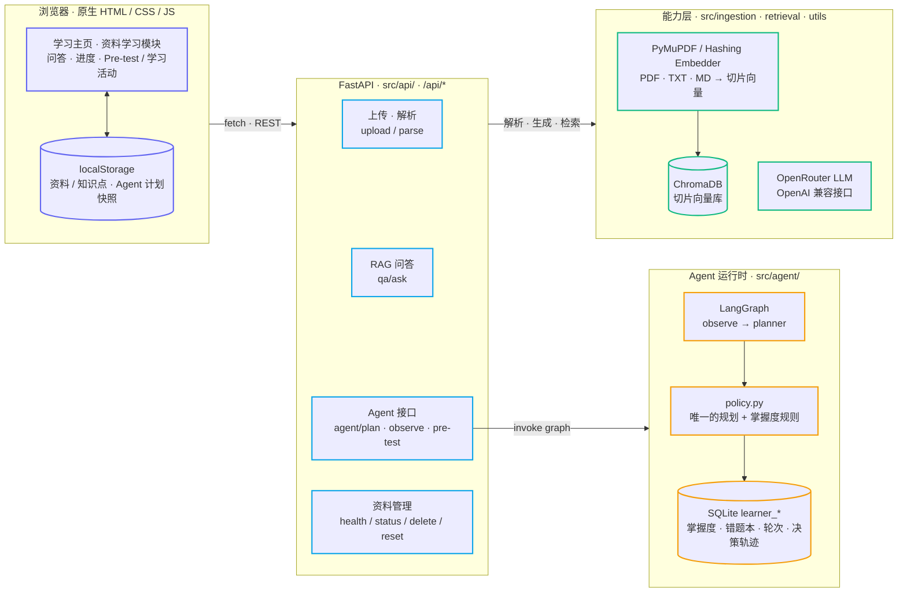

# Adaptive Study Assistant Agent — 学生端

> **面向自主学习的自适应学习助手**  
> 学生自主上传课程资料，系统基于 LLM 与 RAG 自动解析并生成讲解与 quiz，提供自主学习路径推荐与 AI 问答。


| 项目信息 | 内容                                                                    |
| ---- | --------------------------------------------------------------------- |
| 项目名称 | Adaptive Study Assistant Agent — 学生端                                  |
| 项目类型 | 课程项目 / 原型系统                                                           |
| 目标用户 | 需要自主学习专业课程知识的大学生                                                      |
| 核心能力 | 学生自主上传课程资料 → LLM 自动解析并生成 quiz；学习主页按资料文件分类进入独立学习模块；课程资料 + AI 问答；学习进度追踪 |


---

## 目录

- [1. 项目简介](#1-项目简介)
- [2. 功能特性](#2-功能特性)
- [3. 系统架构](#3-系统架构)
- [4. 前端技术栈](#4-前端技术栈)
- [5. 后端技术栈](#5-后端技术栈)
- [6. 项目结构](#6-项目结构)
- [7. 快速开始](#7-快速开始)
- [8. API 接口](#8-api-接口)
- [9. 实验](#9-实验)
- [10. 已知限制](#10-已知限制)
- [11. 开发约定](#11-开发约定)

---

## 1. 项目简介

系统围绕「学生自主上传课程资料」这一入口，形成完整闭环：

```
学生上传课程资料（每份资料 = 一个独立学习模块）
    → LLM 自动解析资料、抽取知识点并生成讲解与 quiz
    → 学习主页按「课程资料文件」分类展示模块卡片，点击选择一份资料
    → 进入该资料模块后才显示自主学习路径：Pre-test → 推荐活动 → 进度追踪
    → 模块内可展开查看课件解析后的知识点（讲解要点 / 生成测验 / 掌握度）
    → 学生完成讲解 / 练习 / 复习，系统只更新该资料的掌握度并重新规划
```

学习主页提供平台功能概览、自主学习规划与课程资料模块入口。选中资料后进入对应模块，完成 Pre-test、讲解 / 练习 / 复习、课件知识点查看与进度追踪，各模块进度独立。「课程资料 · AI 问答」基于上传资料做 RAG 问答并附引用出处；知识点讲解页内也可随时暂停提问，同样由 RAG + LLM 现场作答（以当前讲解页为上下文，答案更贴合正在学的知识点）。

---

## 2. 功能特性

学生端共三个一级页面（另有按资料进入的模块页）+ 三种学习活动：

| 页面                | 功能                                                                             |
| ----------------- | ------------------------------------------------------------------------------ |
| **学习主页**          | 平台功能概览、自主学习规划、课程资料文件卡片（知识点数 / 掌握度 / 解析状态）；点击卡片选中资料，点「进入学习模块」进入对应模块             |
| **资料学习模块**（选中资料后） | 该资料的课件解析概览、自主学习路径（先 Pre-test，再由 Agent 推荐下一步）、课件解析后的知识点（可展开查看讲解要点与生成测验）、本资料学习记录 |
| **课程资料 · 问答**     | 自主上传课程资料（PDF / TXT / MD）、AI 解析资料生成知识点与 quiz、AI 问答（带引用出处）、从资料列表直接进入模块           |
| **学习进度**          | 按资料范围筛选的整体掌握度、各知识点掌握度条形图、学习轨迹                                                  |

> **按资料隔离**：每个知识点通过 `_materialId` 绑定所属资料，Pre-test 状态、掌握度、推荐活动与学习记录都只在该资料模块内生效，不同资料之间互不干扰。

三种学习活动。**下一步由 LLM 在合法候选里挑选并给出理由**（`planner_llm.py`）；下表是候选的成立条件，只描述"什么时候可以做"，不规定"应该先做哪个"：

| 活动        | 何时可能被推荐（候选条件）              | 说明                                                             |
| --------- | ----------------------------- | -------------------------------------------------------------- |
| **知识点讲解** | 有讲解页，且未掌握                  | 基于上传资料生成的分页讲解，可随时暂停提问（RAG + LLM 现场作答，并附引用出处）；看完最多到 55%         |
| **知识复习**  | 错题本还有 ≥ 1 道题                 | 针对历史错误的闪卡回顾，只清错题、不涨掌握度                                         |
| **练习测验**  | 题库非空                          | 针对资料内容生成的测验题；`Δ = clamp(round((正确率×100 − 掌握度)×0.6), −10, +25)` |
| **收尾**    | 掌握度 ≥ 80% 且错题清空               | 该知识点结束；`policy.decide()` 在实验里也这样定义"完成"，但产品不再用它排程                |

模型的选择可以与任何"经验规则"不同——这正是"决策权在模型"的含义；每次选择都会附带一句引用具体数字的理由，显示在界面的「判定依据」里。

自适应规划遵循 `Plan → Act（浏览器）→ Observe → Update → Re-plan` 闭环：每次作答后由 agent 更新掌握度与错题本，再由模型重新决定下一步。

---

## 3. 系统架构



上传 → 切片向量化入库 → LLM 生成知识点 / 讲解 / quiz → 前端按资料归属；问答时检索相关片段 + LLM 作答并附引用。

**规划只有一条路径**：页面上的「下一步」不再是前端算出来的，而是 `POST /api/agent/plan` 调用 LangGraph agent，由 `src/agent/policy.py` 决策后返回。前端只缓存与渲染这份快照（`localStorage` 里的 `agent.plans`），没有任何备用规则——后端不可用时界面显示「Agent 未连接」，不会偷偷换一套逻辑。

---

## 4. 前端技术栈

前端**完全采用原生 HTML / CSS / JavaScript**，无任何框架与构建步骤（零依赖，双击 `index.html` 即可运行，或经本地静态服务器访问）。

| 组件    | 技术                  | 说明                                                                                                          |
| ----- | ------------------- | ----------------------------------------------------------------------------------------------------------- |
| 页面结构  | **HTML5**           | 单页应用外壳（`#app` 根节点 + hash 路由）                                                                                |
| 样式    | **CSS3**            | `styles.css` 设计系统（CSS 变量、卡片、进度条、环形进度等）                                                                      |
| 交互逻辑  | **原生 JavaScript**   | 模块化 IIFE：`ui.js` / `data.js` / `engine.js` / `views-student.js` / `app.js` / `api.js`                       |
| 路由    | **hash 路由**         | `#/student/dashboard`、`#/student/material/:id`、`#/student/pretest/:id`、`#/student/progress/:scope` 等，无需后端路由 |
| 状态持久化 | **localStorage**    | 学习状态（当前资料、掌握度、轨迹）本地保存，刷新不丢                                                                                  |
| 后端通信  | **fetch API**       | `js/api.js` 封装 REST 调用（`/api/*`）                                                                            |
| 本地服务  | **Node.js 内置 http** | `server.js` 零依赖静态服务器（可选）                                                                                    |

前端脚本依赖关系（`index.html` 中的加载顺序）：

```
js/ui.js              # 图标 + 通用 UI 组件（toast / bar / ring / card）
js/data.js            # 活动类型 + 问答文案
js/engine.js          # 按资料隔离的知识模型 + Agent 计划快照（规则在服务端）
js/api.js             # 后端 HTTP API 封装（含 /api/agent/*）
js/views-student.js   # 学习主页 / 资料模块 / 问答 / 进度 / Pre-test / 活动视图
js/app.js             # 应用外壳 + hash 路由（含资料模块与资料级路由参数）
```

---

## 5. 后端技术栈

| 组件       | 技术                        | 作用                                                                |
| -------- | ------------------------- | ----------------------------------------------------------------- |
| API 框架   | **FastAPI**               | 暴露学生端 REST 接口（`src/api/`）                                         |
| LLM 接入   | **OpenRouter**（OpenAI 兼容） | 解析资料抽取知识点、生成 quiz、RAG 问答                                          |
| 向量检索     | **ChromaDB**              | 上传资料的切片向量存储与语义检索                                                  |
| 文本向量化    | **Hashing（确定性词袋哈希）**      | 无外部模型依赖，离线可复现的文本向量                                                |
| 资料解析     | **PyMuPDF** + 纯文本         | PDF / TXT / MD 提取正文                                               |
| Agent 编排 | **LangGraph**             | `observe → planner` 两个节点：先更新状态，再重新规划；`/api/agent/*` 直接 invoke 这个图 |
| 决策（下一步） | **LLM**（`src/agent/planner_llm.py`） | 模型在合法候选里挑一个动作并给出理由；结构化 JSON，校验不过就本步不给决策，**不退回规则** |
| 合法性与测量   | **`src/agent/policy.py`** | 定义合法动作空间、掌握度更新、掌握判定、滚动轮次；纯函数，产品与实验共用 |
| 学习状态     | **SQLite（`learner_*` 表）** | 掌握度、错题本、轮次、决策轨迹（`learner_step`）由服务端持久化                            |

### 5.1 决策由模型做，测量由代码做

一句话：**"下一步学什么"交给 LLM，"学会了没有"留在代码里。**

| 归谁 | 内容 | 位置 |
| --- | --- | --- |
| LLM | 从候选里选一个动作 + 写出理由（引用掌握度与错题数） | `LLMPlanner.choose()` |
| 代码 | 枚举合法候选：没题不能练、未前测不入列、已掌握不入列 | `legal_candidates()` |
| 代码 | 校验模型的选择：幻觉 id、不存在的活动、原样重复上一步 | `validate_choice()` |
| 代码 | 只给事实：状态、掌握度、错题数；**不产生任何候选旁的动作** | `policy.plan_facts()` |
| 代码 | 把模型选择写成计划里唯一的下一步，并标记该知识点的判定 | `apply_decision()` |
| 代码 | 掌握度更新 / 掌握判定 / 轮次推进（**未改动**） | `policy.apply_result()` 等 |

**为什么掌握度不交给模型**：掌握度是度量，是 learning gain 的地面真值。把度量交给被评估的对象，实验就没有结论了——所以 `apply_result` / `is_mastered` / `plan_material` 保持纯函数，模型只碰"选哪个"。

开关与失败处理（**没有自动降级到规则**）：

- `config.yaml -> agent.planner`：`llm`（默认）或 `rule`（显式的演示/测试模式，不会自动切换过去）
- 无 Key → 不构造任何"规则计划"顶替；响应 `agent.decided_by = unavailable`、`model_connected = false`、`unavailable_reason = no_api_key`，前端直接显示"未接入模型"
- 主模型返回了"没法用的内容"（截断、散文、JSON 非法、选了不存在的知识点）→ **换兜底模型重判一次**：`agent.planner_escalation_models`（默认取 `llm.fallback_models`），token 预算提到 1200，仍由模型决策。成功时 `decision.escalated = true`，前端在"判定依据"处标出"备用模型重判"
- 强模型仍然给不出 → 不退回 `policy.decide()`；`decided_by = unavailable`，`unavailable_reason` 为 `call_failed` 或 `bad_output`，`decision.attempts` 列出每个被问过的模型及失败原因，`next` 为空
- 计划里的 `steps` 只有模型选中的那一步；`by_topic` 只有事实（`pretest / ready / done / blocked`），不含代码猜的动作
- 同一学情命中决策缓存 → 不再调用模型，同状态必然同决策（8 seed 重跑可比）
- **延迟**：单次决策 4–6 s（8 个知识点约 1.4k prompt token；包含错误回灌与升级重判的平均值是 5.2 s）。为不让这几秒挡住页面，`/api/agent/observe` 支持 `decide=false`：先返回掌握度更新（约 10 ms），前端渲染结果页，再用 `/api/agent/plan` 把"下一步"补上。学生按下"完成"到看见分数是即时的

---

## 6. 项目结构

```text
Adaptive-Study-Assistant-Agent_AI-Concepts-Project/
├── README.md                       # 本文档
├── requirements.txt                # Python 依赖（含 fastapi / uvicorn）
├── .env.example                    # 密钥 / 端点模板（不含真实密钥）
├── .gitignore                      # 忽略 .env / 数据 / 向量库 / 数据库
├── config.yaml                     # 非敏感配置（唯一配置源）
├── frontend/                       # ★ 学生端前端（原生 HTML/CSS/JS）
│   ├── index.html                  # 入口
│   ├── styles.css                  # 设计系统
│   ├── server.js                   # 零依赖本地静态服务器（可选）
│   ├── package.json                # npm start 脚本
│   └── js/
│       ├── ui.js                   # 图标 + UI 组件
│       ├── data.js                 # 活动类型 + 问答文案
│       ├── engine.js               # 把 agent 快照翻译成界面状态 + 上传流程
│       ├── api.js                  # 后端 HTTP API 封装
│       ├── views-student.js        # 学习主页 / 资料模块 / 问答 / 进度等视图
│       └── app.js                  # 应用外壳 + 路由
├── src/
│   ├── api/                        # ★ 学生端 HTTP API
│   │   ├── app.py                  # FastAPI 应用与路由（资料 / 问答 / 进度）
│   │   ├── agent.py                # /api/agent/*：规划、状态更新、Pre-test、轨迹
│   │   ├── services.py             # 资料解析 / quiz 生成 / RAG 问答
│   │   └── run.py                  # 启动入口
│   ├── agent/                      # Agent 运行时
│   │   ├── policy.py               # ★ 掌握度更新 / 掌握判定 / 事实视图（plan_facts；decide 仅实验）
│   │   ├── planner_llm.py          # ★ LLM 决策器：合法候选 + 结构化输出 + 校验 + 缓存（无规则回退）
│   │   ├── prompts/                # 提示词（decision.py 决策、templates.py CLI 讲解/出题）
│   │   ├── learner_store.py        # learner_topic / learner_roll / learner_step
│   │   ├── serve.py                # LangGraph 图 + 服务封装（产品实际调用）
│   │   ├── graph.py                # CLI 闭环（python -m src.agent.run），含 Teach 渲染
│   │   ├── planner.py              # CLI 阈值规划器（0–1 标度，实验不使用）
│   │   └── run.py                  # CLI 驱动
│   ├── ingestion/                  # PDF/TXT 解析与切片
│   ├── retrieval/                  # 向量库与嵌入
│   ├── student_model/              # CLI 侧学生状态模型 + events 日志
│   └── utils/                      # 配置 / LLM 客户端 / 密钥守卫
├── data/
│   ├── course_materials/           # 课程 PDF（不入库）
│   ├── uploads/                    # 学生上传的资料（不入库）
│   └── chroma_db/                  # ChromaDB 持久化（不入库）
└── tests/                          # 离线单元测试
```

---

## 7. 快速开始

### 7.1 环境要求

- Python 3.10+、pip
- Node.js ≥ 16（仅前端可选本地服务需要；也可直接用 Python http.server）
- OpenRouter API Key（LLM 解析 / 问答需要，填在本地 `.env`）
- 内存：无大模型加载需求（内置 hashing 嵌入，常规配置即可）

### 7.2 后端安装与启动

```bash
cd Adaptive-Study-Assistant-Agent_AI-Concepts-Project

python -m venv .venv
# Windows (PowerShell)：.venv\Scripts\Activate.ps1
# Windows (Git Bash)：source .venv/Scripts/activate
# macOS / Linux：source .venv/bin/activate

python -m pip install --upgrade pip
pip install -r requirements.txt
cp .env.example .env        # Windows PowerShell: Copy-Item .env.example .env
```

在 `.env` 中填入真实 Key（`.env` 已被 `.gitignore` 忽略，绝不入库）：

```dotenv
OPENROUTER_API_KEY=sk-or-your-key-here
OPENROUTER_BASE_URL=https://openrouter.ai/api/v1
```

启动后端：

```bash
python -m src.api.run --port 8000
# 默认 http://127.0.0.1:8000，健康检查：
# curl http://127.0.0.1:8000/api/health
```

### 7.3 前端启动

```bash
# 方式一（推荐）：Python 静态服务器
cd frontend
python -m http.server 8080

# 方式二：Node 零依赖服务器
cd frontend
npm start        # 或 node server.js

# 方式三：直接双击 index.html（部分浏览器 file:// 下会禁用 localStorage）
```

浏览器打开 <http://localhost:8080> ，默认后端地址 `http://localhost:8000`。

> 若后端部署在其他地址，可在浏览器控制台设置 `localStorage.asa_api_base = 'http://你的后端地址'` 后刷新。

---

## 8. API 接口

| 方法     | 路径                             | 说明                                                                                                                                                                         |
| ------ | ------------------------------ | -------------------------------------------------------------------------------------------------------------------------------------------------------------------------- |
| GET    | `/api/health`                  | 健康检查，返回 LLM 配置状态                                                                                                                                                           |
| POST   | `/api/materials/upload`        | 上传资料（multipart，PDF/TXT/MD）                                                                                                                                                 |
| POST   | `/api/materials/parse`         | LLM 解析资料 → 抽取知识点 + 生成讲解与 quiz；解析途中资料被删除时返回 **410**（结果整体丢弃，不写缓存）                                                                                                            |
| GET    | `/api/materials/{material_id}` | 查询资料解析状态与缓存结果（刷新后恢复）                                                                                                                                                       |
| DELETE | `/api/materials/{material_id}` | 删除指定资料：磁盘文件、ChromaDB 向量、解析缓存、知识点与 agent 学习状态一并清理；在跑的解析线程随后会看到删除标记并丢弃结果                                                                                                     |
| POST   | `/api/materials/reset`         | 重置全部数据（上传资料、课程材料、ChromaDB 索引与向量库文件），平台回到初始状态                                                                                                                               |
| POST   | `/api/qa/ask`                  | RAG + LLM 问答，返回 `{ answer, sources, grounded, mode }`；可选 `material_id` / `material_name`（限定检索资料）与 `topic` / `focus`（知识点讲解页随堂提问：当前知识点名 + 当页讲解内容，答案按助教讲解方式组织，`mode="tutor"`） |

页面上的规划与掌握度全部来自 `/api/agent/*`。

### 8.1 Agent 接口（页面上的「下一步」唯一来源）

| 方法   | 路径                               | 说明                                                                  |
| ---- | -------------------------------- | ------------------------------------------------------------------- |
| GET  | `/api/agent/policy`              | 当前服务的策略与引擎：`{policy:"adaptive-v1", engine:"langgraph"}`             |
| POST | `/api/agent/plan`                | 重新规划：返回 `{round, steps, next, by_topic, topics}`；`next` 就是界面上的「下一步」 |
| POST | `/api/agent/observe`             | 一次活动结束后更新状态并重新规划：返回 `{result:{before,after,delta,note}, ...plan}`   |
| POST | `/api/agent/pre-test`            | 写入各知识点的起点分（答对 45% / 答错 20% / 跳过不变）                                  |
| GET  | `/api/agent/state/{material_id}` | 该资料的权威学习状态 + 最近 20 条决策轨迹                                            |
| POST | `/api/agent/reset`               | 清空某份资料（或全部）的学习状态                                                    |


`plan` 请求里的 `topics` 只在**首次接触**时用于播种（浏览器升级前已有进度不会丢）；之后以 SQLite 为准，浏览器清缓存不会清掉学习记录。

示例（解析资料）：

```bash
curl -X POST http://127.0.0.1:8000/api/materials/parse \
  -H "Content-Type: application/json" \
  -d '{"material_id": "<上传返回的 id>"}'
```

### 8.2 方法 vs 基线（报告口径）

报告里只能有一个 method。当前仓库里确实存在两套掌握度模型，但它们不是"两份没写完的实现"，而是 **method 与 baseline**，边界由 `tests/test_p9_single_method.py` 守着：

| 维度 | Method（被评估） | Baseline（仅对照） |
| ---- | ---- | ---- |
| 代码 | `src/agent/policy.py`（`adaptive-v1`） | `src/student_model/mastery.py` + `src/agent/planner.py` |
| 谁在用 | 产品 `/api/agent/*`（`serve.py`）；实验里的 `adaptive` 方法 | 仅 `src/agent/graph.py`（旧 CLI 链路，实验不使用） |
| 掌握度标度 | 0–100 整数百分比 | 0–1 浮点 |
| 更新式 | `Δ = clamp(round((正确率×100 − m) × 0.6), −10, +25)`；讲解首次 +10、重看 +2、封顶 55 | `m' = 0.7·m + 0.3·p` |
| 达标条件 | `m ≥ 80` **且**错题本为空 | `m ≥ 0.85`（无错题概念） |
| 决策输入 | 掌握度 + 错题本 + `failStreak` + 讲解次数 + 内容可用性 | 掌握度 + `recent_errors` + 上一步活动 |
| 阈值来源 | 代码常量，随每次规划下发（`mastered_at` / `explain_cap`） | `config.yaml` 的 `mastery:` / `planner:` 段 |
| 报告角色 | **method** | **遗留 CLI 实现（非实验基线）** |

> 实验的三条基线（LLM-only / RAG / Fixed-strategy）定义在 `experiments/methods.py`，是 `(content, planner)` 配对；其中固定课程表用 `methods.CyclicPlanner`，**不是** `planner.py`。报告口径以 `policy.py` + `methods.py` 这一条链路为准。

> **决策者与测量者的分工**：产品的"下一步"由 LLM 在合法候选里选（`planner_llm.py`），`policy.decide()` 不再出现在产品路径上（只剩实验基线与显式 `rule` 模式）；掌握度更新、达标判定、轮次推进仍 100% 在 `policy.py`。**实验口径已对齐**：`adaptive` 分支回放的是模型的决策（`experiments/data/decisions.json`），不再调用 `policy.decide()`；若某状态没有记录，脚本直接报错而不是退回规则——否则测的就不是 agent 了。

两条纪律：

1. `config.yaml` 的 `mastery:` 与 `planner:` 两段已显式标注 **BASELINE**，且不含 method 的任何常量——method 的数字只在 `policy.py` 里有一份。
2. 前端不保存任何阈值：`isMastered()` 读快照的 `by_topic[topic_id].mastered`，文案里的百分比读 `mastered_at`。所以界面上的"已掌握"与报告里的判定永远是同一个函数算的。

---

## 9. 实验

实验分三步：先把课程讲义冻结成题库与两种讲解条件，再让**真正的 agent** 为每条学情做一次决策并冻结，最后离线回放四个 tutor 的等预算对比。

| 步骤 | 脚本 | 内容 | 产物 | 是否调用模型 |
| ---- | ---- | ---- | ---- | ---- |
| 内容准备 | `experiments/content.py` | 两种讲解条件的生成与打分，16 次调用 | `data/materials.json` | 一次 |
| 决策建库 | `experiments/collect_decisions.py` | agent 为每个会话每一步做决策，1172 条 | `data/decisions.json` | 一次（约 1200 次） |
| 等预算对比 | `experiments/run_experiment.py` | 四方法 × 5 画像 × 8 种子 = 160 次会话 | `results/e1_main.json` + 3 张图 | **不调用** |

这样切分的理由：agent 的"下一步"由模型决定，既慢（4–6 s/步）又随机。**决策只买一次**，之后改指标、改图、重跑统计全是离线读取，不再消耗额度；同时"同一学情 → 同一决策"也保证了配对比较（同画像同种子）成立。

内容准备是对比实验的输入：模拟学生把讲解带来的增益乘以算出的 `coverage`，所以先有覆盖率的测量，才有 LLM-only 与 RAG 的差距。对比实验本身离线运行，不联网、不需要 API Key。

### 9.1 数据集（两步共用）

题库不是手写示例，而是用本产品的解析链路跑出来的。课程发的实验讲义已随仓库提供，一条命令即可复现：

```bash
python -m experiments.build_bank     # 默认读 experiments/data/source/Experiment(Lecture 1 Intro 2026).pdf
```

该命令按页分片调用 `src/api/services.py` 的 `EXTRACT_SYSTEM` / `EXTRACT_USER`（与网页上传同一套提示词），输出 `experiments/data/parse_raw.json`。本次从 68 页讲义得到 **20 个知识点、56 道题**，每条带页码。分片是必要的：免费模型单次补全约 1 万字符即被截断（实测 `Unterminated string`）。

> 课件版权归课程与授课教师所有，随仓库提供仅用于实验复现与课程评审，不得再分发。仓库若转为公开，先删除 `experiments/data/source/`：`parse_raw.json` 已含带页码的摘录。

`parse_raw.json` 只是来源凭证，实验**只读**人工整理后的 `experiments/data/bank.json`：

| 项目 | 数值 |
| ---- | ---- |
| 知识点 | 8 个（AI 定义 / ML 的 `<P,T,E>` / 深度学习 / 大数据 4V / 数据驱动转向 / AI 任务与应用 / 回归 vs 分类 / ML 三分类） |
| 练习题 | 32 道（每点 4 道，供练习活动使用） |
| 探针题 | 24 道（每点 3 道，只用于前测/后测，从不出现在练习中） |
| 难度 | 每题手工标注 0–1，供模拟学生计算答对概率 |
| 校验 | id 唯一、答案下标合法、练习与探针互不重叠（`experiments/bank.py`） |

被丢弃的是课程行政页（roadmap、物流、关键词趋势）与 5 道残缺题。

### 9.2 两种内容条件（内容准备）

proposal 的三条基线里有两条差的是**讲解从哪来**，不是怎么排活动。题库只有题、没有讲解，所以这一层必须单独生成：

```bash
python -m experiments.content            # 生成缺失的部分
python -m experiments.content --force    # 全部重新生成
```

对 8 个知识点，用同一任务、同一模型（temperature 0）各生成一次：

| 条件 | 提示词 | 上下文 |
| ---- | ---- | ---- |
| `rag` | `TEACH_SYSTEM`（只用给出的讲义摘录） | 检索到的 3 段讲义原文 |
| `llm_only` | 换成"你没有课件，凭自身知识讲，不要编造页码" | 无 |

检索优先走产品自己的 Chroma 检索器；干净 clone 里通常没有索引，因此回退到同一份 PDF 的 TF-IDF 索引，切块参数与产品一致（800 字符、100 重叠）。实际使用的后端写入 `materials.json` 的 `retrieval_backend`（本次为 `tfidf-chunks`）。

生成结果与两项离线打分冻结在 `experiments/data/materials.json`：

| 指标 | 定义 | LLM-only | RAG |
| ---- | ---- | ---- | ---- |
| `coverage` | 讲解覆盖"探针题考点词"的比例 | 0.274 | **0.439** |
| `grounding` | 讲解与检索段落的最高 TF-IDF 余弦 | 0.141 | **0.289** |
| tokens / 知识点 | 生成成本 | 568 | 1040 |
| 平均延迟 | 单次调用 | 3.2 s | 3.0 s |

`coverage` 是主实验实际消费的数；`grounding` 解释它为什么更高——RAG 的讲解更贴讲义措辞。两者在个别知识点上会打架（`what is AI` 覆盖率持平但 grounding 差一倍），图 5 里原样保留。

内容准备的样本是 8 个知识点、每条件只生成一次，因此它是**描述性对比**，不报显著性或置信区间。

### 9.3 四个 tutor = 内容源 × 调度器

| 方法 | 内容源 | 调度 | 相对上一行多出的能力 |
| ---- | ---- | ---- | ---- |
| `llm_only` | LLM-only | 每点 1 讲解 + 1 练习 | —（proposal 的 LLM-only Tutor） |
| `rag` | RAG | 每点 1 讲解 + 1 练习 | 检索（proposal 的 RAG Tutor） |
| `fixed` | RAG | 讲解→练习→练习，固定循环 | 教学流程（proposal 的 Fixed-strategy Tutor） |
| `adaptive` | RAG | **LLM agent**（`planner_llm.py`，回放冻结决策） | 读学生状态自己决定下一步（本方法） |

相邻两行只差一个变量，所以差值可归因：`llm_only → rag` 是检索，`rag → fixed` 是教学流程，`fixed → adaptive` 是"由模型而不是课程表决定下一步"。

`adaptive` 走的不是另一套实现：实验调用产品同一个 `LLMPlanner`，产物是"学情 → 决策"的冻结表（`experiments/decisions.py`）。回放时若某状态不在表里，脚本直接报错而不是退回 `policy.decide()`——否则测的就不是 agent 了。

### 9.4 一次会话怎么跑

`experiments/simulator.py` 的模拟学生持有每个知识点各自的私有能力 θ，Agent 看不到它，只能看到答对/答错。答对概率由能力与题目难度之差决定，再叠加 8% 手滑与 20% 蒙对。

一次会话：前测（每点 1 道探针定起点）→ 循环「调度器选活动 → 学生现场作答 → `policy.apply_result` 更新掌握度 → 重新规划」→ 到预算或全部掌握为止 → 后测（同一组探针题的期望得分）。

两条与"活动价值"有关的建模前提，都在模拟器 docstring 里写明：

- **讲解增益 × `coverage`**：没讲到考点的讲解教不会考点。这是 LLM-only 与 RAG 差距的来源。
- **练习增益 × 已受教程度**：`instruction = 0.3 + 0.7 × min(1, 读到过的最好覆盖率)`。不加这一项，模拟器会给出一个荒谬的最优解——**什么都不读、只刷题**得分最高（0.178 vs 固定循环 0.164），等于说没被讲过的东西也能靠做题学会。

agent 侧还有一条规则性约束（不是偏好，属于"合法性"）：**一轮之内每个待学知识点只安排一次**。`legal_candidates()` 把本轮已服务的知识点移出候选，模型仍然决定选哪个点、做什么活动。没有这条约束时实测 32 步里有 15 步压在两个点上，另外三个点一次没读过——这和迁移到模型之前"规则排课保证覆盖"的行为相比是退步。

### 9.5 主实验结果

```bash
python -m experiments.collect_decisions      # 只跑一次：agent 做 1172 次决策
python -m experiments.run_experiment         # 离线回放，秒级完成
```

160 次会话（4 方法 × 5 画像 × 8 种子），结果写入 `experiments/results/e1_main.json`：

```
method          pre   post    gain     sd  mastered  steps
llm_only      0.501  0.577  +0.076  0.031      2.48   31.4
rag           0.501  0.606  +0.105  0.040      2.98   31.3
fixed         0.501  0.615  +0.114  0.045      3.15   31.1
adaptive      0.501  0.633  +0.132  0.050      3.42   31.1
```

配对差值（同画像同种子，bootstrap 95% CI，40 对）：

| 对照 | Δgain | 95% CI | d_z | 胜场 | Δ达标知识点（胜场） |
| ---- | ---- | ---- | ---- | ---- | ---- |
| LLM-only Tutor | **+0.057** | [+0.049, +0.064] | +2.26 | 40/40 | +0.95（15/40） |
| RAG Tutor | **+0.027** | [+0.023, +0.032] | +1.91 | 39/40 | +0.45（11/40） |
| Fixed-strategy Tutor | **+0.018** | [+0.013, +0.022] | +1.20 | 35/40 | +0.28（9/40） |

> 达标知识点的胜场少是**打平**造成的，不是负向：`strong` 画像四个方法都拿到 8/8，`struggling` 多数在 0，这些配对记为平局；均值差为正来自 `medium` / `mixed` 的那几次会话。

相邻两档的链式差值（同一批 40 对）：

| 改动 | Δgain | 95% CI | d_z | 胜场 |
| ---- | ---- | ---- | ---- | ---- |
| 加检索（`llm_only → rag`） | +0.029 | [+0.025, +0.033] | +2.44 | 40/40 |
| 加教学流程（`rag → fixed`） | +0.010 | [+0.007, +0.013] | +0.98 | 35/40 |
| 决策交给模型（`fixed → adaptive`） | **+0.018** | [+0.013, +0.022] | +1.20 | 35/40 |

1. **检索仍是最大的一步**：同样调度、同样题目，只把讲解换成检索版，增益 0.076 → 0.105，40/40 全胜，d_z = 2.4。
2. **教学流程再加一档**：固定循环把增益推到 0.114（相对 RAG +0.010，35/40）。
3. **把决策权交给模型是第三个显著增量**（+0.018，CI 不含 0，35/40）。它没有被告诉"讲解→练习→练习"这个循环，自己走到了 8.2 讲解 / 17.1 练习 / 5.7 复习，并且 40 次会话产生 **40 条互不相同的活动序列**（固定循环只有 5 条）。
4. **分画像（`fixed → adaptive` 配对）**：`struggling` +0.024（8/8）、`weak` +0.029（8/8）、`medium` +0.014（8/8）、`mixed` +0.021（7/8），`strong` −0.000（4/8）。**收益集中在还有选择余地的学习者身上**，`strong` 是天花板效应（开局就把 8 个点全部推到 0.75 以上，四个方法都是 8）。
5. **这个增量是"修"出来的，不是调出来的**：v1 的 agent 与固定循环打平（−0.001），根因是提示词漏掉了两条机制事实——达标要求错题清零、而清空错题本只有复习一条途径。补上之后 `review` 从 0.2 次/会话升到 5.7 次，重读讲解从 11.2 次降到 8.2 次，40 个会话里 39 个出现复习（首次出现在第 17 步，中位数）。同一批种子上的提示词消融：**v1 → v2 = +0.016 [+0.010, +0.022]，17/20，d_z = 1.09**（`results/e1_main_v1.json` 与 `data/decisions_v1.json` 保留为对照）。

> 实验口径的一个细节：`adaptive` 的决策是**冻结后回放**的，所以它是"模型产出的策略"而不是"每次重新采样"。这才让同画像同种子的配对比较成立，也让改指标、改图、重跑统计不再产生 API 成本。三行基线在 v1/v2 两次运行中逐对完全相同（最大绝对差 0.000000），所以 v1→v2 的差值只能来自 agent 那一行。

### 9.6 指标定义（只保留三个）

| 指标 | 定义 |
| ---- | ---- |
| `pre` / `post` | 探针题期望得分均值（0–1）；`post` 即 Final Mastery |
| `learning_gain` | `post − pre`，主指标 |
| `mastered_topics` | 后测 ≥ 0.75 的知识点个数（0–8），与 Agent 内部达标线无关，避免自证 |

去掉的指标及原因：`normalized_gain` 与 `learning_gain` 排序完全一致；`estimate_mae` 衡量的是"Agent 是否自估准确"，与"帮学生学多少"无关且四个方法都靠同一个 `apply_result` 更新；`activities_to_target` 会被"开局已过线"的强学习者记成 1 步，均值失真；`content_quality` / 活动配比是机制描述，不是结果指标，放在正文而不是表里。

### 9.7 出图

```bash
python -m experiments.plots
```

只读 `e1_main.json`，不重新模拟，因此图与提交的 JSON 一一对应。3 张 300 dpi PNG 写入 `experiments/results/figures/`：

| 文件 | 内容 | 对应论点 |
| ---- | ---- | ---- |
| `fig1_learning_gain.png` | 四方法学习增益 + 95% CI | 主结果 |
| `fig2_gain_by_profile.png` | 按画像拆分的增益 | 收益集中在有选择余地的画像 |
| `fig3_paired_delta.png` | 配对差值 + bootstrap CI | 显著性与胜场 |

---

## 10. 已知限制

实验层面（报告必须写明的部分）：

- **模拟学生不是真人**：能力 θ、手滑 8%、蒙对 20%、四条增益假设（讲解收益递减、练习按"正确率 × 已受教程度"计收益、练习不能替代讲解、复习只在有错时有效，见 `experiments/simulator.py` 模块 docstring）都是模型假设。实验检验的是"这些假设下四种方法谁更好"，不是人类学习曲线。
- **内容质量按线性方式接入**：讲解增益乘以 `coverage` 是一次线性缩放，未校准真实学习者的"覆盖率→掌握度"映射，也未做敏感性扫描。该映射若次线性，RAG 与 LLM-only 的差距被高估；若超线性则被低估。
- **`coverage` 是词面指标**：数的是"探针考点关键词是否出现在讲解里"，同义改写会漏记，因此绝对值偏低（0.27–0.44）不代表讲解只有三成有效。它适合比较两个条件，不适合当绝对质量分。
- **每个条件只生成一次**：temperature 0 下每个知识点只有一条讲解，未估计生成方差；生成过程中出现过 3 次拒答/截断（已重试）。
- **RAG 检索可能不是产品那套**：干净 clone 没有 Chroma 索引，脚本回退到同一份 PDF 的 TF-IDF 分块索引；只有 `retrieval_backend` 为 `product-chroma` 时才是产品链路。
- **难度由人工标注**：`bank.json` 的难度是手工标注，不是实证校准；模型只能选活动类型与知识点，不选难度。因此实验衡量的是 activity-level adaptation，不是 difficulty-level adaptation。
- **agent 的优势依赖提示词是否说清机制，这一点必须承认**：v1 提示词下 agent 与固定循环打平（−0.001，CI 跨 0）；补上"达标要求错题清零 / 清空错题本只有复习一条途径"之后为 +0.018。也就是说，0.018 里有多少是"模型会规划"、多少是"提示词把关键约束讲清楚了"，本实验无法完全分离——**准确的表述是"在写清机制事实的前提下，把决策交给模型优于手工循环"**。同一批种子上 v1→v2 的消融为 +0.016（17/20，d_z = 1.09），可作为这个量的上界参考。
- **`review` 的收益在模拟器里大于产品里**：产品 `policy.apply_result` 给 review 的掌握度增量是 0（只清错题本），模拟器则让 review 真实提升 θ。模型看到的是产品口径（"复习不加掌握度"），它选择复习因此更值得肯定，而不是被模型"利用"了模拟器漏洞。但这确实意味着产品与实验在"复习价值"上不完全等价，属于已知偏差。
- **样本是 8 个种子**：40 对配对比较，bootstrap CI 以配对差值重采样 2000 次。再收窄 CI 需要更多种子，每多一个种子约 150 次模型调用（决策必须重新采集）。
- **决策建库有一次 4/1139 的暂时性失败**：4 个状态在首轮里两个模型都没给出可用回复（返回散文/空），会话因此提前结束；清掉这 4 个状态重跑后全部正常回答，最终 `no_decision = 0`。失败原始记录留在 `decisions.json` 的 `meta.recovered_after_retry`，建库脚本的重试轮次已从 3 提到 5。这类失败是**模型层的抖动**，不是策略性质。
- **决策由一次性建库冻结**：`decisions.json` 是"模型产出的策略"而不是每次重采样。改提示词、改候选规则、改模拟器都会让旧决策失效，必须重新建库——这也是为什么它不是免费的。
- **主实验离线运行**：讲解与决策都由前置阶段生成一次后冻结（`materials.json` / `decisions.json`），模拟阶段不联网、不需要 API Key。

产品层面：

- **决策由 LLM 做出，因此有成本与延迟**：每次“下一步”约 1.4k–2.3k prompt token、4–6 s（v2 提示词比 v1 长，且 12% 的步数会升级到兜底模型）。链路上有三道处理：末尾强指令 + 同模型一次错误回灌 → 换兜底模型重判（`planner_escalation_models`，token 预算 1200）→ 决策缓存。全部失败时**不用规则顶替**，而是本步返回“无决策”：`agent.decided_by = unavailable`，`unavailable_reason` 取 `no_api_key` / `call_failed` / `bad_output`，`decision.attempts` 记录每个被问过的模型，`next` 为空。
- **LLM 模型配置**：主模型为付费 `deepseek/deepseek-v4.1-flash-1017`（**钉住的日期快照**，约 $0.0002 / 次决策），`fallback_models` 配第三方 `z-ai/glm-5.3-flash` 兜底（跨厂商，避免同一家挂了两个 id 一起挂）。免费模型已停用：它是 429 限流和"返回散文/被截断"的主要来源。可在 `config.yaml -> llm` 更换；`decisions.json` 的 `meta.model` 记录决策实际用哪个模型，`meta.prompt_hash` 记录决策实际用哪版提示词，二者都进了决策缓存的键，改任一项都必须重建决策库。
- **页面等待态**：决策的 2 秒不再阻塞结果页——`observe(decide=false)` 先落状态（~10 ms），结果页立即出现，再用 `/plan` 补上"下一步"；期间按钮转圈、结果页给骨架、页面顶部有进度条，避免用户以为点坏了。
- **学习状态存于后端 SQLite**：掌握度、错题本、滚动轮次与决策轨迹由 `learner_*` 表持久化，浏览器只缓存最近一次 agent 快照用于渲染。清浏览器数据不丢记录，但换机器/换浏览器共享同一份状态（单用户原型，未做账号隔离）。
- **嵌入后端**：固定为 `hashing`（确定性词袋哈希 + L2 归一化 cosine），无外部模型依赖、离线可复现；属于词面匹配而非语义嵌入，同义改写与跨语言检索能力有限。
- **资料格式**：支持 PDF / TXT / MD；PPT 暂不支持（可先导出为 PDF）。
- **单用户**：课程原型，未实现多用户认证与数据隔离。

---

## 11. 开发约定

- 前端无构建步骤，修改 `frontend/` 下文件后刷新浏览器即可生效。
- 敏感信息（`OPENROUTER_API_KEY`）只放在本地 `.env`，绝不写入代码 / README / 前端；提交前运行 `python -m src.utils.secret_guard`。
- 基础设施参数（模型、路径、检索、种子）在 `config.yaml`；method 的阈值与常量只在 `src/agent/policy.py`，不复制到 YAML。`.env` 只放密钥与端点。
- 提交信息建议格式：`feat:` / `fix:` / `docs:` / `exp:`。

